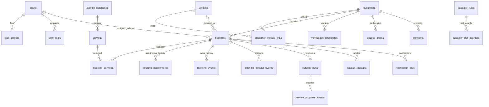

# DPAuto – DATABASE DESIGN

> **Mã tài liệu:** DPA-DB-001  
> **Phiên bản:** 1.0 – Thiết kế kỹ thuật dự thảo  
> **Ngày:** 10/11/2026  
> **Hệ quản trị:** PostgreSQL  
> **Nguồn:** `DPAuto_Conversation_Handoff_2026-11-09.md`, `DPAuto_Booking_Requirements.md`, `BUSINESS_RULES.md`, `USER_FLOW.md`.  
> **Trạng thái:** Chưa phê duyệt thiết kế cuối cùng; các quyết định D01–D14 còn mở.

## 1. Mục tiêu, phạm vi và trạng thái quyết định

Thiết kế cơ sở dữ liệu cho **hệ thống DPAuto độc lập**: website giới thiệu, yêu cầu đặt lịch, phân công cố vấn, điều phối sức chứa, tiếp nhận xe, tiến độ dịch vụ, lịch sử thực hiện, tra cứu có xác minh, thông báo nội bộ và khả năng mở rộng Zalo OA. **Không đồng bộ phần mềm đặt lịch cũ**, không dùng chung schema dữ liệu với Xe Lướt Toàn Trung.

**Ngoài MVP:** kho, phụ tùng, phiếu sửa chữa kỹ thuật chuyên sâu, báo giá/hóa đơn, thanh toán, lương/chấm công, ứng dụng native, tự động gửi Zalo OA.

**Quy ước:** **[CHỐT]** = phạm vi đã thống nhất; **[REQ]** = thiết kế bám bản Requirements nhưng còn chờ duyệt nghiệp vụ; **[ĐỀ XUẤT]** = lựa chọn kỹ thuật cần rà soát; **[CẦN CHỐT Dxx]** = phụ thuộc quyết định D01–D14. Không xem tên bảng, kiểu cột hoặc SQL mẫu là quyết định nghiệp vụ đã được duyệt.

## 2. Nguyên tắc kiến trúc dữ liệu

1. **[CHỐT]** Một database PostgreSQL riêng cho DPAuto; không join trực tiếp vào database bán xe. Có thể chạy cùng VPS ban đầu nếu tài nguyên cho phép.
2. **[ĐỀ XUẤT]** Kiến trúc modular monolith: một API làm chủ transaction, dùng migration có phiên bản; không để frontend truy cập DB trực tiếp.
3. **[REQ]** Kiểm tra quyền ở API theo vai trò **và từng bản ghi**. `MANAGER` xem toàn trạm; `ADVISOR` thao tác lịch đang phụ trách, xem lịch sử đã từng phụ trách theo phạm vi giới hạn.
4. **[REQ]** Tách **lịch hẹn** (`bookings`), **lượt phục vụ thực tế** (`service_visits`), **mốc tiến độ** (`service_progress_events`) và **nhật ký thay đổi**.
5. **[ĐỀ XUẤT]** UUID cho khóa chính; `timestamptz` cho thời điểm; hiển thị múi giờ `Asia/Ho_Chi_Minh`; tiền tệ chưa cần trong MVP; không dùng biển số/SĐT làm khóa chính.
6. **[ĐỀ XUẤT]** Không xóa cứng lịch và audit trong vận hành thường ngày. Dữ liệu cá nhân cần chính sách lưu giữ, chỉnh sửa, ẩn danh/xóa phù hợp và kiểm soát quyền riêng.
7. **[REQ]** Mọi thay đổi nhạy cảm có actor, thời điểm, giá trị trước/sau phù hợp; chống gửi lặp và kiểm soát cập nhật đồng thời.
8. **[ĐỀ XUẤT]** Các bảng nội dung CMS website có thể thiết kế ở phân hệ riêng; không trộn với transaction đặt lịch.

## 3. Phân hệ và danh mục bảng

| Nhóm | Bảng | Mục đích | Ưu tiên |
|---|---|---|---|
| Nhân sự | `users`, `staff_profiles`, `user_roles` | Đăng nhập, nhân sự, hai vai trò nghiệp vụ | P1 |
| Khách/xe | `customers`, `vehicles`, `customer_vehicle_links` | Liên hệ, xe, quan hệ có thể thay đổi | P1/P4 |
| Dịch vụ | `service_categories`, `services`, `booking_services` | Danh mục và dịch vụ được yêu cầu | P1 |
| Lịch hẹn | `bookings`, `booking_assignments`, `booking_events` | Lịch, người phụ trách, lịch sử thay đổi | P1/P2 |
| Sức chứa | `business_hours`, `calendar_blocks`, `capacity_rules`, `capacity_slot_counters` | Giờ hoạt động, ngoại lệ, sức chứa, chống overbooking | P3 |
| Điều phối | `waitlist_requests`, `booking_contact_events` | Chờ chỗ, liên hệ, đề xuất đổi giờ | P3 |
| Phục vụ | `service_visits`, `service_progress_events` | Lượt thực hiện và tiến độ công khai/nội bộ | P3 |
| Tra cứu | `verification_challenges`, `access_grants` | Xác minh và quyền truy cập ngắn hạn | P4 |
| Đồng ý | `consents` | Bằng chứng đồng ý xử lý/liên hệ/khuyến mãi | P1/P4 |
| Vận hành | `audit_logs`, `idempotency_keys`, `notification_jobs` | Audit, chống trùng, hàng đợi thông báo | P1/P5 |
| Website | `content_pages`, `news_posts`, `media_assets` | **Tùy chọn**, chỉ triển khai khi chốt CMS | Sau khi chốt UI/CMS |

**Lưu ý:** `capacity_slot_counters`, `customer_vehicle_links`, `booking_contact_events`, `idempotency_keys` là bảng **[ĐỀ XUẤT]** bổ sung để hiện thực hóa nghiệp vụ an toàn. Không bắt buộc phải dùng đúng cấu trúc này nếu giải pháp transaction khác chứng minh được tính nhất quán.

## 4. Sơ đồ quan hệ ERD (logic)



**Quan hệ trọng tâm:** một `booking` có nhiều dịch vụ và sự kiện, tối đa một `assigned_advisor_id` hiện hành, có lịch sử phân công; một `booking` có tối đa một `service_visit` ở MVP. Quan hệ khách–xe có thể nhiều-nhiều theo thời gian; cần xác minh trước khi cho xem dữ liệu xe.

## 5. Quy ước trường chung

| Trường | Kiểu đề xuất | Quy tắc |
|---|---|---|
| `id` | `uuid` | PK; tạo bằng `gen_random_uuid()` |
| `created_at`, `updated_at` | `timestamptz` | UTC khi lưu, chuyển giờ ở UI; `updated_at` do ứng dụng/trigger cập nhật |
| `deleted_at` | `timestamptz NULL` | Chỉ cho thực thể hỗ trợ soft delete; không áp dụng mù quáng cho audit |
| `version` | `integer NOT NULL DEFAULT 1` | Optimistic concurrency; tăng khi cập nhật bản ghi trọng yếu |
| `metadata` | `jsonb` | Chỉ cho thuộc tính mở rộng không quan trọng; không thay thế cột có index/ràng buộc |
| `created_by`, `updated_by` | `uuid NULL` | FK đến `users` nếu hành động nội bộ; nguồn public/system phải thể hiện rõ |

**Mã công khai:** `bookings.code` là mã tra cứu thân thiện, `UNIQUE`, không chứa SĐT/biển số và **không tự cấp quyền xem lịch**. Mã không thay thế OTP/token.

## 6. Đặc tả bảng – nhân sự và phân quyền

### 6.1 `users` [REQ]

| Cột | Kiểu | Ràng buộc/ý nghĩa |
|---|---|---|
| `id` | uuid | PK |
| `email` | `varchar(254)` | `UNIQUE` dạng chuẩn hóa; có thể nullable nếu auth dùng định danh khác |
| `auth_subject` | text | `UNIQUE`, ID từ hệ thống xác thực; **không** lưu mật khẩu dạng rõ |
| `status` | text | `ACTIVE`, `SUSPENDED`, `DISABLED` (đề xuất) |
| `last_login_at` | timestamptz | NULL được |
| `created_at`, `updated_at` | timestamptz | NOT NULL |

**[ĐỀ XUẤT]** Nếu tự host auth, bổ sung bảng credentials/session riêng và thiết kế theo chuẩn an toàn; không nhét refresh token plaintext vào `users`.

### 6.2 `staff_profiles` [REQ]

`user_id uuid PK/FK users(id)`, `full_name varchar(150) NOT NULL`, `phone_normalized varchar(20) NULL`, `staff_code varchar(40) UNIQUE NULL`, `active_from timestamptz NULL`, `inactive_at timestamptz NULL`, `created_at`, `updated_at`.

### 6.3 `user_roles` [REQ]

`user_id uuid FK`, `role_code text CHECK (role_code IN ('MANAGER','ADVISOR'))`, `assigned_at timestamptz`, `assigned_by uuid NULL FK users`; PK `(user_id, role_code)`. **[CẦN XÁC NHẬN]** Một tài khoản có thể đồng thời giữ hai vai trò hay chỉ một? Đề xuất một vai trò nghiệp vụ hiệu lực tại một thời điểm, enforce bằng `UNIQUE(user_id)` nếu duyệt.

**Quyền không dựa duy nhất vào role:** đối với `ADVISOR`, phải kiểm tra `bookings.assigned_advisor_id = current_user_id`; lịch sử chuyển giao đọc qua `booking_assignments` và projection giới hạn.

## 7. Đặc tả bảng – khách hàng và phương tiện

### 7.1 `customers` [REQ]

| Cột | Kiểu | Ghi chú |
|---|---|---|
| `id` | uuid PK | Định danh nội bộ |
| `full_name` | varchar(150) NOT NULL | Tên liên hệ |
| `phone_normalized` | varchar(20) NOT NULL | Chuẩn hóa số Việt Nam tại API |
| `email` | varchar(254) NULL | Tùy chọn |
| `notes_internal` | text NULL | Không đưa ra API công khai |
| `created_at`, `updated_at` | timestamptz | Bắt buộc |
| `deleted_at` | timestamptz NULL | Theo chính sách dữ liệu |

**Không `UNIQUE(phone_normalized)` mặc định:** cùng số có thể liên hệ cho nhiều người; không tự gộp hồ sơ. Tạo index theo số điện thoại để tìm có kiểm soát. Không trả lời có/không tồn tại khách trước khi xác minh.

### 7.2 `vehicles` [REQ]

`id uuid PK`, `plate_normalized varchar(20) NULL`, `brand varchar(100) NULL`, `model varchar(120) NULL`, `model_year smallint NULL`, `vin varchar(32) NULL`, `color varchar(60) NULL`, `created_at`, `updated_at`.

**Không `UNIQUE(plate_normalized)`** vì thay biển, trùng dữ liệu nhập và chuyển chủ. VIN nếu dùng để định danh cần quy tắc xác thực/chuẩn hóa trước khi đặt unique; không tự suy ra quyền sở hữu từ VIN hoặc biển số.

### 7.3 `customer_vehicle_links` [ĐỀ XUẤT]

`id uuid PK`, `customer_id uuid FK`, `vehicle_id uuid FK`, `relationship text` (ví dụ `OWNER`, `CONTACT`, `AUTHORIZED_USER`), `verified_at timestamptz NULL`, `valid_from timestamptz NOT NULL`, `valid_to timestamptz NULL`, `verification_source text NULL`, `created_at`. Ràng buộc `valid_to IS NULL OR valid_to > valid_from`.

Đây là quan hệ liên hệ/ủy quyền, **không tự động là bằng chứng pháp lý sở hữu**. Quyền tra cứu vẫn dựa vào xác minh và `access_grants` theo phạm vi cụ thể.

## 8. Danh mục dịch vụ

### 8.1 `service_categories` [REQ]

`id uuid PK`, `code varchar(50) UNIQUE NOT NULL`, `name varchar(150) NOT NULL`, `description text NULL`, `is_active boolean NOT NULL DEFAULT true`, `sort_order integer DEFAULT 0`, `created_at`, `updated_at`.

### 8.2 `services` [REQ]

`id uuid PK`, `category_id uuid FK NOT NULL`, `code varchar(50) UNIQUE NOT NULL`, `name varchar(150) NOT NULL`, `description text NULL`, `is_bookable boolean DEFAULT true`, `estimated_intake_minutes integer NULL CHECK (>0)`, `created_at`, `updated_at`.

`estimated_intake_minutes` là **ước lượng tiếp nhận**, không phải cam kết thời gian sửa chữa; không dùng mặc định để suy ra thời điểm hoàn thành.

### 8.3 `booking_services` [REQ]

`booking_id uuid FK`, `service_id uuid FK`, `requested_note text NULL`, `created_at`; PK `(booking_id, service_id)`. **[ĐỀ XUẤT]** Lưu thêm `service_name_snapshot` để giữ tên tại thời điểm đặt, tránh thay đổi lịch sử khi danh mục được đổi tên.

## 9. Lịch hẹn – bảng trung tâm

### 9.1 `bookings` [REQ]

| Cột | Kiểu | Ràng buộc/ý nghĩa |
|---|---|---|
| `id` | uuid | PK |
| `code` | varchar(32) | UNIQUE, mã công khai không nhạy cảm |
| `customer_id` | uuid | FK NOT NULL |
| `vehicle_id` | uuid | FK NULL; khách có thể chưa cung cấp xe |
| `requested_start_at` | timestamptz | NOT NULL; thời điểm mong muốn |
| `requested_end_at` | timestamptz | NULL; nếu UI chọn khoảng |
| `confirmed_start_at` | timestamptz | NULL trước khi xác nhận |
| `confirmed_end_at` | timestamptz | NULL, **thời gian tiếp nhận**, không phải kết thúc sửa chữa |
| `status` | text | `PENDING`, `CONFIRMED`, `ARRIVED`, `COMPLETED`, `CANCELLED`, `NO_SHOW` |
| `assigned_advisor_id` | uuid | FK `users`, NULL nếu chưa phân công |
| `source` | text | `WEBSITE`, `QR`, `PHONE`, `FANPAGE`, `ZALO`, `WALK_IN`, `STAFF`, `OTHER` (đề xuất) |
| `source_detail` | text | NULL; chiến dịch/QR cụ thể nếu có |
| `created_by` | uuid | FK NULL nếu khách tự gửi |
| `customer_request_note` | text | NULL |
| `internal_note` | text | NULL, không public |
| `contact_outcome` | text | NULL; không thay thế `status` |
| `proposed_start_at` | timestamptz | NULL; chưa tự áp dụng |
| `cancelled_at`, `completed_at` | timestamptz | NULL; thời điểm thực tế |
| `cancellation_reason` | text | NULL |
| `version` | integer | NOT NULL DEFAULT 1, CHECK >=1 |
| `created_at`, `updated_at` | timestamptz | NOT NULL |

**[CẦN CHỐT D01–D05, D10, D14]** Phân công mặc định, thời gian chọn, chính sách PENDING giữ chỗ, cách tính suất, hủy sau khi đã đến, ngưỡng không đến.

**Ràng buộc cơ sở:** `requested_end_at > requested_start_at` nếu có; `confirmed_end_at > confirmed_start_at` nếu có; `CONFIRMED/ARRIVED/COMPLETED` thông thường phải có `confirmed_start_at` (các ngoại lệ walk-in cần thiết kế rõ); `status` hợp lệ; FK. Các điều kiện xuyên nhiều bảng và chuyển trạng thái phải được kiểm tra trong service transaction, không chỉ CHECK.

### 9.2 `booking_assignments` [REQ]

`id uuid PK`, `booking_id uuid FK NOT NULL`, `advisor_id uuid FK users NOT NULL`, `assigned_by uuid FK users NULL`, `assigned_at timestamptz NOT NULL`, `unassigned_at timestamptz NULL`, `reason text NULL`, `created_at`. **Index unique có điều kiện** `(booking_id) WHERE unassigned_at IS NULL` để tối đa một assignment đang hiệu lực. `bookings.assigned_advisor_id` phải đồng bộ trong **cùng transaction**; không cập nhật trực tiếp một bên.

### 9.3 `booking_events` [REQ]

`id uuid PK`, `booking_id uuid FK`, `event_type text NOT NULL`, `actor_user_id uuid FK NULL`, `actor_type text NOT NULL` (`CUSTOMER`, `STAFF`, `SYSTEM`), `from_status text NULL`, `to_status text NULL`, `before_data jsonb NULL`, `after_data jsonb NULL`, `reason text NULL`, `occurred_at timestamptz NOT NULL`. Append-only ở tầng nghiệp vụ; chỉ ghi trường cần audit, **không** sao chép OTP, token, toàn bộ dữ liệu nhạy cảm.

### 9.4 `booking_contact_events` [ĐỀ XUẤT]

`id uuid PK`, `booking_id uuid FK`, `advisor_id uuid FK NULL`, `channel text`, `outcome text`, `proposed_start_at timestamptz NULL`, `customer_accepted boolean NULL`, `note_internal text NULL`, `contacted_at timestamptz NOT NULL`. Lưu trao đổi đổi giờ, gọi xác nhận, không biến đề xuất thành lịch xác nhận khi chưa được khách đồng ý.

## 10. Khung giờ, ngày nghỉ và sức chứa

### 10.1 `business_hours` [REQ]

`id uuid PK`, `weekday smallint CHECK (weekday BETWEEN 0 AND 6)`, `opens_at time NOT NULL`, `closes_at time NOT NULL`, `is_open boolean NOT NULL`, `effective_from date`, `effective_to date NULL`, `created_at`, `updated_at`; CHECK `closes_at > opens_at` với khung trong ngày. Nếu có nhiều ca/nghỉ trưa, lưu **nhiều dòng cho một ngày**; cần ràng buộc không chồng lấn khi publish cấu hình.

### 10.2 `calendar_blocks` [REQ]

`id uuid PK`, `starts_at timestamptz NOT NULL`, `ends_at timestamptz NOT NULL`, `block_type text` (`HOLIDAY`, `MAINTENANCE`, `MANUAL_CLOSE`, `OTHER`), `service_category_id uuid NULL`, `reason text NULL`, `created_by uuid`, `created_at`; CHECK `ends_at > starts_at`. Dùng cho nghỉ lễ, đóng bất thường, đóng theo nhóm dịch vụ nếu được duyệt.

### 10.3 `capacity_rules` [REQ; CẦN CHỐT D04–D05]

`id uuid PK`, `service_category_id uuid NULL`, `effective_from date NOT NULL`, `effective_to date NULL`, `slot_minutes integer NOT NULL CHECK (>0)`, `max_confirmed integer NOT NULL CHECK (>=0)`, `max_pending integer NULL CHECK (>=0)`, `minimum_lead_minutes integer DEFAULT 0`, `maximum_advance_days integer NULL`, `is_active boolean DEFAULT true`, `created_by uuid`, `created_at`, `updated_at`.

**[ĐỀ XUẤT MVP]** Tính **tổng số suất tiếp nhận/khung**, `PENDING` không giữ suất chính thức nhưng bị giới hạn số yêu cầu chờ. Cấu hình nhóm dịch vụ chỉ kích hoạt sau khi D05 được duyệt. Tránh các rule hiệu lực chồng lấn không có độ ưu tiên xác định.

### 10.4 `capacity_slot_counters` [ĐỀ XUẤT]

`id uuid PK`, `capacity_rule_id uuid FK`, `slot_start_at timestamptz NOT NULL`, `confirmed_count integer NOT NULL DEFAULT 0 CHECK (>=0)`, `pending_count integer NOT NULL DEFAULT 0 CHECK (>=0)`, `version integer NOT NULL DEFAULT 1`, `updated_at`; UNIQUE `(capacity_rule_id, slot_start_at)`.

**Quan trọng:** Đây là **cache giao dịch của sức chứa**, không phải nguồn sự thật duy nhất. Phải có job đối soát counters với lịch và cách xử lý thay đổi rule/slot. Nếu không cần bảng counter, có thể khóa hàng `capacity_rules`/slot tương ứng và đếm lịch trong transaction; cần benchmark và chứng minh không overbook. Không khóa chỉ bằng SELECT COUNT không đồng bộ.

### 10.5 `waitlist_requests` [REQ; CẦN CHỐT D03]

`id uuid PK`, `customer_id uuid FK`, `vehicle_id uuid NULL`, `booking_id uuid NULL`, `service_category_id uuid NULL`, `desired_from timestamptz`, `desired_to timestamptz`, `status text` (`WAITING`, `CONTACTED`, `CONVERTED`, `EXPIRED`, `CANCELLED`), `contact_permission boolean`, `created_at`, `updated_at`. Danh sách chờ **không** là lịch xác nhận và không giữ suất; liên hệ khách trước khi thay đổi giờ.

## 11. Lượt phục vụ, tiến độ và lịch sử dịch vụ

### 11.1 `service_visits` [REQ]

| Cột | Kiểu | Ý nghĩa |
|---|---|---|
| `id` | uuid PK | Lượt phục vụ |
| `booking_id` | uuid UNIQUE FK NOT NULL | Tối đa một lượt/booking ở MVP |
| `vehicle_id` | uuid FK NOT NULL | Xe thực sự tiếp nhận |
| `received_at` | timestamptz NOT NULL | Thời điểm nhận xe |
| `current_progress` | text | Mốc hiện tại |
| `public_summary` | text NULL | Tóm tắt được phép công bố |
| `internal_summary` | text NULL | Nội bộ |
| `odometer_km` | integer NULL CHECK (>=0) | Nếu được ghi nhận |
| `next_service_due_at` | date NULL | Nếu có; D14 trong handoff nói cần cân nhắc mốc này, còn Requirements D14 là thời gian no-show |
| `ready_at`, `handed_over_at` | timestamptz NULL | Mốc thực tế |
| `completed_at` | timestamptz NULL | Kết thúc lượt |
| `created_at`, `updated_at`, `version` | ... | Kiểm soát thay đổi |

**Chú ý sai khác nguồn:** Mã D14 trong **Requirements** là thời gian chờ `NO_SHOW`; câu hỏi lưu ngày bảo dưỡng tiếp theo xuất hiện trong **handoff** như một câu hỏi riêng, không được đánh đồng. Trường `next_service_due_at` là **tùy chọn [CẦN XÁC NHẬN]**.

**Không tạo `service_visit` chỉ vì lịch đã `CONFIRMED`.** Chỉ tạo khi tiếp nhận thực tế (`ARRIVED`) theo workflow được duyệt. Một lịch hẹn hủy/không đến không trở thành lịch sử dịch vụ.

### 11.2 `service_progress_events` [REQ; CẦN CHỐT D07, D12]

`id uuid PK`, `service_visit_id uuid FK`, `progress_code text NOT NULL`, `actor_user_id uuid FK`, `visibility text NOT NULL CHECK (visibility IN ('PUBLIC','INTERNAL'))`, `public_message text NULL`, `internal_note text NULL`, `estimated_finish_at timestamptz NULL`, `occurred_at timestamptz NOT NULL`, `created_at`.

Bộ mốc dự kiến: `RECEIVED`, `INSPECTING`, `WAITING_APPROVAL`, `IN_SERVICE`, `QUALITY_CHECK`, `READY_FOR_PICKUP`, `HANDED_OVER`. Có thể bỏ qua mốc không áp dụng **nếu D07 được duyệt**, nhưng không tạo sự kiện giả. Khi chuyển `HANDED_OVER` và `COMPLETED`, cập nhật nhất quán trong transaction. `current_progress` là giá trị tổng hợp để đọc nhanh, events là lịch sử nguồn.

**Ranh giới công khai:** API khách chỉ lấy `visibility='PUBLIC'` và trường cho phép; không serialize nguyên bản ghi có `internal_note` rồi lọc ở frontend.

## 12. Xác minh quyền tra cứu và đồng ý dữ liệu

### 12.1 `verification_challenges` [REQ; CẦN CHỐT D08]

`id uuid PK`, `customer_id uuid NULL`, `channel text`, `destination_hash text NULL`, `challenge_hash text NOT NULL`, `purpose text NOT NULL`, `expires_at timestamptz NOT NULL`, `attempt_count integer DEFAULT 0`, `max_attempts integer NOT NULL`, `verified_at timestamptz NULL`, `consumed_at timestamptz NULL`, `created_at`, `request_ip_hash text NULL`.

**Không lưu OTP plaintext.** Băm bằng cơ chế phù hợp cho mã có entropy thấp (ví dụ HMAC khóa máy chủ), giới hạn gửi và thử theo số điện thoại/IP/challenge, hết hạn và dùng một lần. Không tiết lộ hồ sơ tồn tại hay không trước xác minh.

### 12.2 `access_grants` [REQ]

`id uuid PK`, `customer_id uuid FK`, `verification_challenge_id uuid FK NULL`, `token_hash text UNIQUE NOT NULL`, `scope text NOT NULL` (ví dụ `BOOKING_READ`, `CUSTOMER_SERVICE_HISTORY_READ`), `booking_id uuid NULL`, `vehicle_id uuid NULL`, `issued_at timestamptz`, `expires_at timestamptz`, `revoked_at timestamptz NULL`, `last_used_at timestamptz NULL`.

**[ĐỀ XUẤT]** Dùng token ngẫu nhiên khó đoán, chỉ lưu hash; cấp phạm vi **đúng lịch/xe/khách đã xác minh**. Không cho phép token theo một lịch mở toàn bộ lịch sử khách. Cơ chế thu hồi và thời hạn tùy mục đích. Nếu chưa có OTP, chỉ dùng link theo từng lịch có hạn; **không mở tra cứu lịch sử theo SĐT/biển số**.

### 12.3 `consents` [REQ]

`id uuid PK`, `customer_id uuid FK`, `booking_id uuid NULL`, `consent_type text NOT NULL` (`SERVICE_DATA_NOTICE_ACK`, `MARKETING_OPT_IN`, `MARKETING_OPT_OUT`), `granted boolean NOT NULL`, `notice_version varchar(40) NULL`, `source text`, `recorded_at timestamptz`, `evidence jsonb NULL`.

Đồng ý nhận quảng cáo phải **tách biệt** với thông báo xử lý dữ liệu cần thiết; mặc định không opt-in. Lưu bằng chứng tối thiểu, không ghi nội dung bí mật/OTP.

## 13. Audit, idempotency và thông báo

### 13.1 `audit_logs` [REQ]

`id uuid PK`, `actor_user_id uuid NULL`, `actor_type text`, `action text`, `entity_type text`, `entity_id uuid NULL`, `request_id varchar(100) NULL`, `before_data jsonb NULL`, `after_data jsonb NULL`, `reason text NULL`, `occurred_at timestamptz NOT NULL`, `ip_hash text NULL`.

Audit **append-only** theo nghiệp vụ; chỉ Manager/nhân sự được phép đọc. Che hoặc loại trừ token, OTP, credential, dữ liệu nhạy cảm không cần thiết. Phân biệt audit bảo mật toàn hệ thống với `booking_events` để hiển thị lịch sử nghiệp vụ.

### 13.2 `idempotency_keys` [ĐỀ XUẤT]

`id uuid PK`, `scope text NOT NULL`, `key_hash text NOT NULL`, `request_fingerprint text NOT NULL`, `status text NOT NULL`, `resource_id uuid NULL`, `response_code integer NULL`, `expires_at timestamptz NOT NULL`, `created_at`; UNIQUE `(scope, key_hash)`. Cùng khóa + cùng request trả cùng kết quả; cùng khóa + payload khác trả conflict. Cần dọn khóa hết hạn và không giữ dữ liệu cá nhân trong response cache quá mức.

### 13.3 `notification_jobs` [REQ chuẩn bị; Zalo OA sau MVP]

`id uuid PK`, `booking_id uuid NULL`, `customer_id uuid NULL`, `channel text`, `template_key text`, `event_key text NOT NULL`, `payload jsonb`, `status text` (`PENDING`, `PROCESSING`, `SENT`, `FAILED`, `CANCELLED`), `scheduled_at timestamptz`, `attempts integer DEFAULT 0`, `next_attempt_at timestamptz NULL`, `provider_message_id text NULL`, `last_error_code text NULL`, `created_at`, `updated_at`; UNIQUE `(channel, event_key)` theo chiến lược chống trùng.

MVP dùng thông báo nội bộ theo nhu cầu; **không gửi Zalo OA** trước giai đoạn tích hợp. **[ĐỀ XUẤT]** Transactional outbox: ghi job trong cùng transaction với thay đổi lịch; worker gửi sau commit, retry có giới hạn. Gửi thất bại không rollback xác nhận lịch. Phân loại tin dịch vụ và tin khuyến mãi; kiểm tra đồng ý/chính sách trước gửi.

## 14. Trạng thái và bất biến dữ liệu

### 14.1 Trạng thái booking [REQ; CẦN CHỐT D06, D10, D14]

| Từ | Sang hợp lệ thông thường | Điều kiện |
|---|---|---|
| `PENDING` | `CONFIRMED`, `CANCELLED` | Xác nhận sau liên hệ, đủ sức chứa |
| `CONFIRMED` | `ARRIVED`, `CANCELLED`, `NO_SHOW` | Đến thực tế / hủy / quá giờ chờ có kiểm tra |
| `ARRIVED` | `COMPLETED` | Đã bàn giao và có dữ liệu phục vụ tối thiểu |
| `COMPLETED` | Không | Manager xử lý ngoại lệ có audit nếu duyệt |
| `CANCELLED`, `NO_SHOW` | Không | Hẹn lại tạo booking mới/liên kết theo quy tắc duyệt |

Không cho phép API cập nhật trạng thái tùy ý bằng `PATCH status` không qua domain service. Nếu cần rollback trạng thái sau lỗi nhập liệu, thiết kế thao tác sửa ngoại lệ có lý do, quyền Manager và event riêng.

### 14.2 Bất biến cần enforce

- Mỗi booking tối đa **một advisor hiện hành**; Advisor cũ không sửa được sau chuyển giao.
- Lịch `CONFIRMED` chiếm suất theo chính sách duyệt; hủy/không đến/đổi giờ cập nhật sức chứa nhất quán.
- `service_visit` chỉ gắn booking đã thực sự đến; lịch chưa phục vụ không được ghi thành lịch sử dịch vụ.
- `service_progress_events` chỉ ghi cho visit hợp lệ; public API không lộ ghi chú nội bộ.
- Tra cứu lịch sử không mở chỉ nhờ biển số/SĐT/mã booking.
- Thao tác quan trọng tăng `version`, ghi event/audit trong cùng transaction.
- Không dùng `ON DELETE CASCADE` cho booking, visits, assignments, events, audit; ưu tiên `RESTRICT` hoặc quy trình ẩn danh có kiểm soát.

## 15. Transaction và xử lý đồng thời

### TX-01 – Khách tạo yêu cầu

1. Xác thực payload, nguồn, thời gian, rate limit/Turnstile (tại API).
2. Kiểm tra idempotency; khóa bản ghi idempotency hoặc xử lý conflict.
3. Trong transaction: kiểm tra slot còn nhận yêu cầu theo chính sách `PENDING` đã duyệt; tạo/tìm hồ sơ liên hệ **không tự gộp tùy tiện**; tạo booking `PENDING`, dịch vụ, event, consent và job nội bộ nếu có.
4. Commit; trả mã booking + thông báo **chờ xác nhận**, không hứa đã giữ suất khi chưa có chính sách giữ suất.

### TX-02 – Xác nhận suất cuối (chống overbooking)

1. Kiểm tra Manager/Advisor được giao và `version` của booking.
2. Trong transaction: khóa **cùng một tài nguyên slot** (`SELECT ... FOR UPDATE` trên counter/slot đã tạo, hoặc advisory lock ổn định); kiểm tra ngày đóng, rule hiệu lực, số suất còn.
3. Chuyển `PENDING→CONFIRMED`, cập nhật giờ và counter, tăng version, ghi `booking_events`/audit/outbox.
4. Commit. Nếu hết suất, rollback và trả conflict để chọn giờ khác.

**Không** thực hiện `COUNT(*)` rồi `UPDATE` ở hai transaction không có khóa chung; có thể xác nhận vượt tải. Khi slot chưa tồn tại, phải `INSERT ... ON CONFLICT` tạo hàng rồi khóa/atomic update, tránh race khi tạo hàng đầu tiên.

### TX-03 – Đổi giờ

Khóa booking và **hai slot theo thứ tự ổn định** để tránh deadlock; kiểm tra quyền, sự đồng ý của khách và sức chứa giờ mới; trong **một transaction** trừ slot cũ, cộng slot mới, cập nhật booking, version, event, audit. Nếu thất bại, suất cũ vẫn giữ nguyên. Nếu `PENDING` không giữ suất thì không trừ suất xác nhận.

### TX-04 – Phân/chuyển cố vấn

Khóa booking; kiểm tra Manager, version, advisor mới hợp lệ; đóng assignment cũ, tạo assignment mới, cập nhật `assigned_advisor_id`, ghi event/audit/outbox; commit một lần. Truy vấn quyền phải dựa vào dữ liệu hiện hành sau commit, không cache quyền cũ quá lâu.

### TX-05 – Tiếp nhận / cập nhật / bàn giao

Khi `CONFIRMED→ARRIVED`: khóa booking, kiểm tra quyền, tạo `service_visit` và event `RECEIVED` một lần (UNIQUE booking_id), ghi audit. Khi cập nhật tiến độ: khóa visit, kiểm tra trạng thái, ghi event rồi cập nhật `current_progress`. Khi bàn giao: ghi `HANDED_OVER`, `completed_at`, `bookings.status=COMPLETED` và event trong cùng transaction.

### TX-06 – Hủy / không đến

Khóa booking + slot liên quan; kiểm tra trạng thái/quyền/thời gian chờ, cập nhật `CANCELLED` hoặc `NO_SHOW`, giải phóng suất nếu đã chiếm, ghi lý do/event/audit, tạo gợi ý liên hệ waitlist sau commit. Không tự ý đổi lịch khách chờ.

### TX-07 – Xác minh OTP/token

Kiểm tra challenge hết hạn, số lần thử, tiêu thụ một lần trong transaction; cấp `access_grant` giới hạn scope, đối tượng và thời hạn; không cho hai request đồng thời dùng một OTP hai lần.

## 16. Index, constraint và tối ưu truy vấn

| Bảng | Index/constraint đề xuất | Phục vụ |
|---|---|---|
| `bookings` | UNIQUE `(code)` | Tra mã |
| `bookings` | `(assigned_advisor_id, requested_start_at DESC)` | Lịch cố vấn |
| `bookings` | `(status, requested_start_at)` | Dashboard và hàng chờ |
| `bookings` | `(confirmed_start_at)` WHERE status IN (`CONFIRMED`,`ARRIVED`) | Sức chứa/lịch xác nhận |
| `bookings` | `(customer_id, created_at DESC)`, `(vehicle_id, created_at DESC)` | Lịch sử có quyền |
| `booking_assignments` | UNIQUE `(booking_id)` WHERE `unassigned_at IS NULL` | Một advisor chính |
| `booking_assignments` | `(advisor_id, assigned_at DESC)` | Lịch sử công việc |
| `booking_events` | `(booking_id, occurred_at DESC)` | Timeline |
| `service_visits` | UNIQUE `(booking_id)`, `(vehicle_id, completed_at DESC)` | Một visit/booking; lịch sử xe |
| `service_progress_events` | `(service_visit_id, occurred_at DESC)` | Timeline tiến độ |
| `customers` | `(phone_normalized)` | Tìm có kiểm soát |
| `vehicles` | `(plate_normalized)` | Tìm có kiểm soát |
| `capacity_slot_counters` | UNIQUE `(capacity_rule_id, slot_start_at)` | Khóa slot |
| `verification_challenges` | `(expires_at)`, `(customer_id, created_at DESC)` | Hết hạn, giới hạn |
| `access_grants` | UNIQUE `(token_hash)`, `(expires_at)` | Xác minh phiên |
| `notification_jobs` | `(status, scheduled_at)` | Worker |
| `idempotency_keys` | UNIQUE `(scope, key_hash)` | Chống lặp |

**[ĐỀ XUẤT]** Dùng partial index theo dữ liệu active khi cần; index trên các cột nhạy cảm cần xem xét mức quyền DB, logging và truy vấn. Không tạo index cho mọi cột; kiểm tra `EXPLAIN (ANALYZE, BUFFERS)` với dữ liệu gần thực tế. Có thể bổ sung index tìm kiếm `pg_trgm` cho tên/biển số sau khi có nhu cầu và đánh giá chi phí.

## 17. SQL DDL minh họa cho các bất biến cốt lõi

> Các đoạn dưới là **mẫu thiết kế**, không phải migration hoàn chỉnh để chạy production. Cần chốt nghiệp vụ, viết migration đầy đủ và kiểm thử trước khi áp dụng.

```sql
CREATE EXTENSION IF NOT EXISTS pgcrypto;

CREATE TABLE bookings (
  id uuid PRIMARY KEY DEFAULT gen_random_uuid(),
  code varchar(32) NOT NULL UNIQUE,
  customer_id uuid NOT NULL REFERENCES customers(id),
  vehicle_id uuid NULL REFERENCES vehicles(id),
  requested_start_at timestamptz NOT NULL,
  requested_end_at timestamptz NULL,
  confirmed_start_at timestamptz NULL,
  confirmed_end_at timestamptz NULL,
  status text NOT NULL DEFAULT 'PENDING'
    CHECK (status IN ('PENDING','CONFIRMED','ARRIVED','COMPLETED','CANCELLED','NO_SHOW')),
  assigned_advisor_id uuid NULL REFERENCES users(id),
  source text NOT NULL,
  created_by uuid NULL REFERENCES users(id),
  version integer NOT NULL DEFAULT 1 CHECK (version >= 1),
  created_at timestamptz NOT NULL DEFAULT now(),
  updated_at timestamptz NOT NULL DEFAULT now(),
  CHECK (requested_end_at IS NULL OR requested_end_at > requested_start_at),
  CHECK (confirmed_end_at IS NULL OR
         (confirmed_start_at IS NOT NULL AND confirmed_end_at > confirmed_start_at))
);

CREATE TABLE booking_assignments (
  id uuid PRIMARY KEY DEFAULT gen_random_uuid(),
  booking_id uuid NOT NULL REFERENCES bookings(id),
  advisor_id uuid NOT NULL REFERENCES users(id),
  assigned_by uuid NULL REFERENCES users(id),
  assigned_at timestamptz NOT NULL DEFAULT now(),
  unassigned_at timestamptz NULL,
  reason text NULL,
  CHECK (unassigned_at IS NULL OR unassigned_at >= assigned_at)
);
CREATE UNIQUE INDEX ux_booking_one_active_assignment
  ON booking_assignments(booking_id) WHERE unassigned_at IS NULL;

CREATE TABLE service_visits (
  id uuid PRIMARY KEY DEFAULT gen_random_uuid(),
  booking_id uuid NOT NULL UNIQUE REFERENCES bookings(id),
  vehicle_id uuid NOT NULL REFERENCES vehicles(id),
  received_at timestamptz NOT NULL,
  current_progress text NOT NULL DEFAULT 'RECEIVED',
  completed_at timestamptz NULL,
  version integer NOT NULL DEFAULT 1 CHECK (version >= 1),
  created_at timestamptz NOT NULL DEFAULT now(),
  updated_at timestamptz NOT NULL DEFAULT now()
);
```

**Lưu ý triển khai:** Các bảng `customers`, `vehicles`, `users` phải được tạo **trước** DDL ví dụ. Ràng buộc `bookings.assigned_advisor_id` khớp assignment hiện hành, `service_visit` chỉ khi ARRIVED, và sức chứa không vượt giới hạn **không thể bảo đảm chỉ bằng DDL trên**: cần transaction/service hoặc trigger được kiểm thử. Với mã booking, dùng generator chống đoán và kiểm tra unique, không dùng chuỗi tuần tự làm token bảo mật.

## 18. API read models và bảo mật truy vấn

| Use case | Nguồn dữ liệu | Bộ lọc bắt buộc |
|---|---|---|
| Dashboard Advisor | `bookings` + `service_visits` | `assigned_advisor_id = auth.user_id` |
| Dashboard Manager | `bookings`, capacity, staff | Xác thực `MANAGER` |
| Lịch sử Advisor | `booking_assignments` + event projection | Từng phụ trách; **chỉ** trường lịch sử được phép |
| Chi tiết booking | `bookings`, services, events | Manager hoặc Advisor hiện hành; khách dùng grant |
| Tra cứu khách | `access_grants`, bookings, visits | Grant chưa hết hạn, đúng scope/booking/vehicle |
| Timeline công khai | `service_progress_events` | `visibility='PUBLIC'`, không trả internal note |
| Báo cáo | `bookings` và tổng hợp | Manager toàn trạm, Advisor chỉ cá nhân |

**Không dùng `SELECT *` trả thẳng ra website.** Tạo DTO/projection riêng cho public, advisor, manager. Tất cả search/export/pagination/aggregate phải áp quyền trước khi trả kết quả. Nếu dùng PostgreSQL RLS như lớp bảo vệ bổ sung, cần bảo đảm DB session mang đúng identity và không tái sử dụng context sai qua pool; **RLS không thay thế auth ở API**.

**Thông tin cá nhân:** log ứng dụng không chứa OTP/token, SĐT đầy đủ trong URL, biển số trong metric label, ghi chú nội bộ hoặc dữ liệu khách khác. Áp rate limit, kiểm soát quyền truy cập backup và mã hóa kênh kết nối.

## 19. Chính sách dữ liệu, backup và vận hành

- **[ĐỀ XUẤT]** Tài khoản DB riêng cho ứng dụng, migration và backup; least privilege, không chạy API bằng superuser.
- **[ĐỀ XUẤT]** Backup PostgreSQL tự động, bản sao ngoài VPS, mã hóa, retention theo chính sách vận hành và **thử restore định kỳ**; chỉ backup mà không restore test chưa đủ.
- **[ĐỀ XUẤT]** Migration có thứ tự, rollback hoặc kế hoạch forward-fix, chạy trên staging với bản dữ liệu đã ẩn danh; không sửa schema production thủ công không lưu version.
- **[ĐỀ XUẤT]** Giám sát slow query, connection pool, disk, WAL, job backlog, lỗi transaction, tỉ lệ conflict và đối soát capacity counters.
- **[CẦN XÁC NHẬN]** Thời hạn lưu booking, hồ sơ khách, OTP, access grant, audit, consent và dữ liệu phục vụ; quy trình xử lý yêu cầu chỉnh sửa/xóa dữ liệu cá nhân.
- **[ĐỀ XUẤT]** Các trường thời gian lưu UTC bằng `timestamptz`; lịch lặp theo ngày địa phương phải tính rõ timezone và DST nếu sau này mở rộng địa điểm khác.

## 20. Lộ trình migration và triển khai database

| Phase | Migration/phân hệ | Điều kiện nghiệm thu |
|---|---|---|
| DB-00 | DB, roles, extensions, migration framework | Database DPAuto riêng, quyền tối thiểu, CI chạy migration sạch |
| DB-01 | `users`, `staff_profiles`, `user_roles`, customers, vehicles, services | Tạo/đọc dữ liệu và phân quyền cơ bản |
| DB-02 | `bookings`, `booking_services`, `booking_assignments`, `booking_events`, `idempotency_keys`, `consents` | Đặt lịch PENDING, giao lịch, audit, chống lặp |
| DB-03 | business hours, blocks, capacity, waitlist, contact events | Không overbook khi cạnh tranh, đổi giờ atomic |
| DB-04 | `service_visits`, `service_progress_events` | Tiến độ đúng lịch đã đến, không lộ ghi chú nội bộ |
| DB-05 | challenges, grants | OTP/token giới hạn phạm vi, không dò lịch sử |
| DB-06 | `notification_jobs`, report indexes, backup/restore | Jobs không gửi trùng, phục hồi được |
| DB-07 | Zalo OA integration tables/fields khi triển khai | Không ảnh hưởng transaction đặt lịch |

**Không triển khai DB-03/DB-05 production trước khi chính sách D03–D05/D08 được chốt.** Các phase trên là thứ tự kỹ thuật đề xuất, có thể điều chỉnh theo implementation plan.

## 21. Test plan cho database (DB-AC)

| Mã | Kịch bản | Kết quả mong đợi |
|---|---|---|
| DB-AC-01 | Advisor A truy cập booking chỉ giao B | API từ chối, không lộ qua search/report |
| DB-AC-02 | Manager chuyển booking A→B | Một assignment hiện hành; A mất quyền sửa, B có quyền |
| DB-AC-03 | Hai request xác nhận suất cuối cùng | Tối đa một thành công, không vượt capacity |
| DB-AC-04 | Đổi slot mới hết chỗ | Rollback toàn bộ, slot cũ không mất |
| DB-AC-05 | Gửi lại request cùng idempotency key | Một booking; payload khác bị conflict |
| DB-AC-06 | `PENDING`/`CANCELLED` được hỏi lịch sử dịch vụ | Không tạo visit giả |
| DB-AC-07 | Tạo visit lần hai cho cùng booking | UNIQUE chặn; retry an toàn |
| DB-AC-08 | Advisor cũ cố cập nhật sau chuyển | Bị từ chối dù giữ ID cũ |
| DB-AC-09 | Public query tiến độ | Chỉ public fields/events, không lộ internal |
| DB-AC-10 | Nhập biển số/SĐT chưa OTP | Không trả dữ liệu cá nhân |
| DB-AC-11 | OTP hết hạn/dùng lại/thử quá lần | Bị từ chối, log bảo mật tối thiểu |
| DB-AC-12 | Token theo booking A đọc booking B | Bị từ chối |
| DB-AC-13 | Hủy booking đã xác nhận | Giải phóng suất đúng một lần |
| DB-AC-14 | Đồng thời chuyển cố vấn và cập nhật lịch | Version/lock chặn lost update |
| DB-AC-15 | Notification worker retry | Không tạo gửi trùng ngoài chiến lược đã duyệt |
| DB-AC-16 | Backup → restore staging | Schema, FK, dữ liệu và quyền hoạt động |
| DB-AC-17 | Dữ liệu khách/xe trùng SĐT/biển số | Không tự gộp hoặc cấp quyền sai |
| DB-AC-18 | Lịch đã hoàn thành sửa trái quyền | Advisor bị từ chối; Manager ngoại lệ có lý do/audit |

Các test liên quan chính sách chưa chốt là **test dự kiến**, cập nhật lại khi D01–D14 được duyệt.

## 22. Quyết định còn mở và ảnh hưởng tới schema

| Mã | Quyết định trong Requirements | Ảnh hưởng database | Hướng tạm thời |
|---|---|---|---|
| D01 | Ai xử lý lịch website? | `assigned_advisor_id`, queue query | NULL, Manager phân công [REQ] |
| D02 | Advisor có tự nhận lịch không? | Permission + assignment event | Không [REQ] |
| D03 | Danh sách chờ khi đầy? | `waitlist_requests` | Có, tùy chọn [REQ] |
| D04 | `PENDING` có giữ suất? | Capacity counters, TTL | Không giữ; giới hạn pending [ĐỀ XUẤT] |
| D05 | Sức chứa chung hay theo dịch vụ? | `capacity_rules.service_category_id` | Tổng suất/slot [ĐỀ XUẤT] |
| D06 | Ai được hoàn thành? | Permission và transition | Advisor hiện hành/Manager [REQ] |
| D07 | Có bỏ qua mốc tiến độ? | Validation progress events | Có, lưu lịch sử [REQ] |
| D08 | Xác minh tra cứu bằng gì? | Challenges/grants/provider | OTP hoặc token theo booking [REQ] |
| D09 | Lịch sử cũ hiển thị đến đâu? | Import provenance nếu bổ sung | Chỉ dữ liệu DPAuto xác thực [REQ] |
| D10 | Đổi/hủy khi đã đến? | Exceptional events | Manager có lý do [REQ] |
| D11 | Advisor cũ xem gì? | Projection từ assignment/events | Tóm tắt quá khứ [REQ] |
| D12 | Mốc tiến độ theo dịch vụ? | Progress codes/config | Bộ mốc chung có bỏ qua [REQ] |
| D13 | Ai quản lý CMS/dịch vụ? | Quyền CMS và bảng nội dung | Manager [REQ] |
| D14 | Chờ bao lâu trước `NO_SHOW`? | Settings/time validation | Manager cấu hình [REQ] |

**Ngoài D01–D14 cần hỏi thêm:** tài khoản có một hay nhiều role; có cần nhập dữ liệu lịch sử cũ thủ công; retention/ẩn danh; số chi nhánh (hiện thiết kế giả định **một trạm**, chưa đưa `branch_id` vào tất cả bảng); có cần lưu mốc bảo dưỡng tiếp theo trong MVP; yêu cầu CMS chi tiết. Đây là **câu hỏi mới**, không tự đánh mã Dxx đã có.

## 23. Checklist trước khi giao Codex viết migration

- [ ] D01–D14 đã có quyết định và cập nhật `BUSINESS_RULES.md` / `USER_FLOW.md` tương ứng.
- [ ] Xác nhận một trạm hay nhiều trạm; nếu nhiều trạm, bổ sung `branches` và scope trước khi migrate.
- [ ] Xác nhận mô hình auth, quyền tài khoản và session.
- [ ] Xác nhận cách tính sức chứa, pending và giới hạn khung giờ.
- [ ] Chốt DTO public/advisor/manager và danh sách trường nhạy cảm.
- [ ] Chốt danh mục status/progress, quy tắc chuyển và ngoại lệ.
- [ ] Chốt retention, backup/restore, quy trình xóa/ẩn danh.
- [ ] Viết migrations **đầy đủ, có thứ tự**, FK/index/check/unique; seed role/service/status/config hợp lệ.
- [ ] Viết transaction tests cho overbooking, đổi giờ, chuyển giao, idempotency.
- [ ] Viết security tests cho OTP/grant, record-level authorization và public projection.
- [ ] Đo hiệu năng trên dataset gần thực tế, rà `EXPLAIN`, xác nhận connection pool phù hợp VPS.

## 24. Kết luận và tài liệu tiếp theo

Thiết kế ưu tiên **đúng nghiệp vụ, phân quyền theo bản ghi, chống overbooking và bảo vệ dữ liệu khách hàng** hơn việc tối đa số bảng. PostgreSQL là nguồn sự thật; API chịu trách nhiệm transaction, trạng thái và quyền; event/audit lưu vết, public projection giới hạn dữ liệu. Các phần chưa chốt phải giữ khả năng điều chỉnh trước migration production.

**Tài liệu tiếp theo:** `API_SPEC.md` và `SYSTEM_ARCHITECTURE.md`, sau khi rà soát D01–D14; `UI_UX_SPEC.md` có thể phát triển song song nhưng không được quyết định thay nghiệp vụ.
