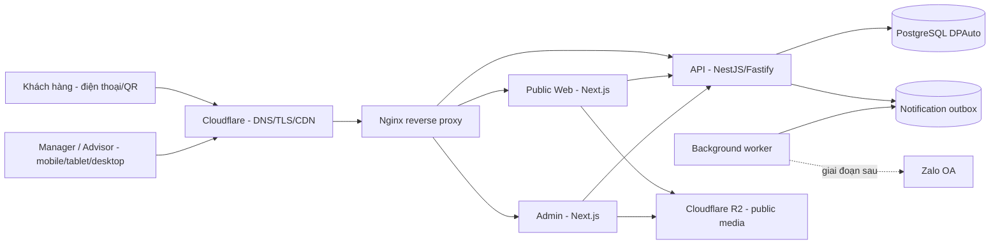
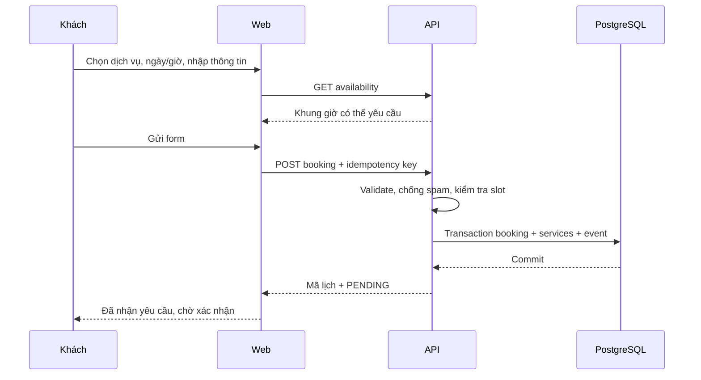
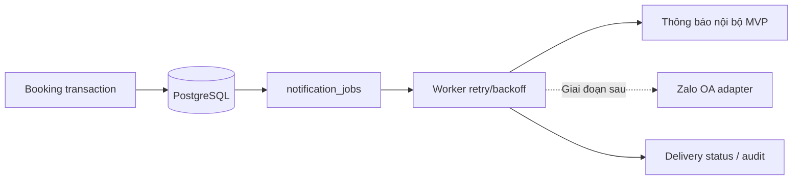
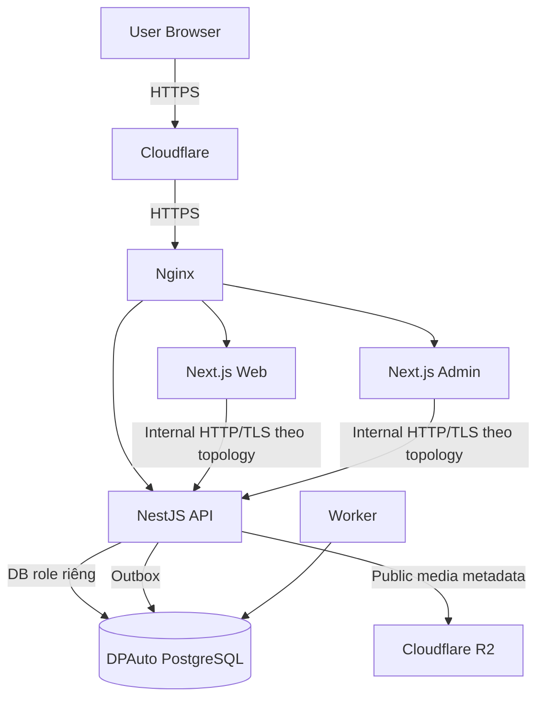

# DPAuto – SYSTEM ARCHITECTURE

> **Mã:** DPA-ARCH-001  
> **Phiên bản:** 1.0 – Dự thảo kiến trúc, 10/11/2026  
> **Phạm vi:** Website công khai, Admin, API, PostgreSQL, media, hạ tầng, bảo mật, vận hành  
> **Nguồn:** `DPAuto_Booking_Requirements.md`, `BUSINESS_RULES.md`, `USER_FLOW.md`, `DATABASE_DESIGN.md`, `API_SPEC.md`  
> **Trạng thái:** Chưa xác nhận toàn bộ tech stack và sizing production; D01–D14 còn mở.

## 1. Bối cảnh và mục tiêu

DPAuto là trạm dịch vụ ô tô Toàn Trung, xây dựng **hệ thống đặt lịch mới độc lập**. MVP gồm website giới thiệu garage/dịch vụ/tin tức/ưu đãi, đặt lịch bằng QR hoặc website, quản lý lịch theo Manager/Advisor, điều phối sức chứa, tiếp nhận và cập nhật tiến độ xe, tra cứu lịch sử dịch vụ có xác minh. Zalo OA triển khai **sau MVP**. Không tích hợp hệ thống lịch cũ; không xây ERP garage, kho, thanh toán hay ứng dụng native trong giai đoạn đầu.

**Nhãn:** [CHỐT] yêu cầu đã thống nhất; [REQ] nội dung trong Requirements đang rà soát; [ĐỀ XUẤT] quyết định kiến trúc chưa phê duyệt; [Dxx] phụ thuộc quyết định nghiệp vụ.

Mục tiêu kiến trúc: độc lập dữ liệu; phân quyền record-level; booking không vượt sức chứa; xử lý concurrent update; không lộ lịch sử xe; mobile-first; có backup/monitoring; đủ đơn giản để vận hành trên VPS và mở rộng về sau.

## 2. Các quyết định kiến trúc (ADR rút gọn)

| ADR | Quyết định | Trạng thái | Lý do / giới hạn |
|---|---|---|---|
| ADR-01 | Hệ thống DPAuto độc lập phần mềm cũ | CHỐT | Không đồng bộ hai chiều |
| ADR-02 | Tách DB DPAuto khỏi Xe Lướt Toàn Trung | CHỐT định hướng | Giảm coupling, dễ backup và phân quyền |
| ADR-03 | Web và Admin Next.js + TypeScript | ĐỀ XUẤT | Tận dụng kinh nghiệm vận hành |
| ADR-04 | API NestJS + Fastify modular monolith | ĐỀ XUẤT | Một nguồn điều phối transaction, dễ mở rộng module |
| ADR-05 | PostgreSQL riêng, migration có version | ĐỀ XUẤT phù hợp Requirements | ACID, row lock, audit |
| ADR-06 | Nginx + Cloudflare + Ubuntu VPS | ĐỀ XUẤT | Hạ tầng tương thích hiện có |
| ADR-07 | R2 cho media public | ĐỀ XUẤT | Tránh phục vụ file nặng từ app server |
| ADR-08 | Outbox + worker cho notification | ĐỀ XUẤT | Lỗi gửi tin không rollback booking |
| ADR-09 | Tra cứu OTP hoặc token theo từng lịch | CHỐT nguyên tắc an toàn; cách chọn D08 | Không lộ dữ liệu qua biển số/SĐT |
| ADR-10 | Không triển khai native app/Zalo OA trong MVP | CHỐT | Chỉ chuẩn bị interface và dữ liệu |

## 3. Sơ đồ ngữ cảnh



Sơ đồ là **kiến trúc mục tiêu đề xuất**, không phải sơ đồ triển khai đã xác nhận. Web/Admin có thể gọi API qua server-side/BFF phù hợp; browser chỉ truy cập public endpoints hoặc endpoints được bảo vệ bằng session và CSRF. Không cấp thông tin kết nối DB cho frontend.

## 4. Phân ranh giới hệ thống

| Thành phần | Chịu trách nhiệm | Không chịu trách nhiệm |
|---|---|---|
| Public Web | Nội dung, form booking, QR, tra cứu đã xác minh | Quyết định cuối cùng về sức chứa/quyền |
| Admin | Dashboard, lịch, thao tác Advisor/Manager | Bỏ qua authorization của API |
| API | Business rules, RBAC, record scope, validation, transaction, audit | Render giao diện |
| PostgreSQL | Dữ liệu nguồn sự thật, constraint, lock, transaction | Quyết định chính sách UI |
| Worker | Xử lý outbox, retry, thông báo nội bộ | Tự sửa trạng thái booking không có rule |
| Cloudflare/R2 | TLS edge, CDN public assets, bảo vệ edge | Lưu dữ liệu booking nhạy cảm trong cache |
| Zalo OA (sau) | Kênh gửi tin theo chính sách | Nguồn sự thật của booking |

## 5. Cấu trúc codebase [ĐỀ XUẤT]

```text
dpauto/
  web/                     # Next.js public
  admin/                   # Next.js Admin mobile-first
  api/                     # NestJS/Fastify modular monolith
    src/modules/
      auth/
      staff/
      customers/
      vehicles/
      services/
      bookings/
      assignments/
      capacity/
      service-visits/
      customer-access/
      notifications/
      reports/
      audit/
    src/common/            # guards, errors, validation, tracing
    migrations/
  worker/                  # notification/outbox jobs, nếu cần
  docs/                    # tài liệu nghiệp vụ và kỹ thuật
  infra/                   # nginx/systemd/backup/monitoring templates
```

Có thể dùng mono-repo hoặc ba repo riêng; **chưa chốt**. Nếu tách repo, hợp đồng API/OpenAPI và migration phải có phiên bản đồng bộ; không chia microservices trong MVP khi chưa có nhu cầu vận hành thực tế.

## 6. Các module backend và ownership

| Module | Dữ liệu chủ quản | Quy tắc chính |
|---|---|---|
| Auth/Staff | `users`, `staff_profiles`, `user_roles` | Hai role, session, vô hiệu hóa nhân viên |
| Booking | `bookings`, `booking_services`, `booking_events` | Vòng đời lịch, idempotency |
| Assignment | `booking_assignments` | Một cố vấn chính; chuyển giao có audit |
| Capacity | `business_hours`, `calendar_blocks`, `capacity_rules`, slot counters nếu chọn | Không overbook; lịch mở/đóng |
| Customers/Vehicles | `customers`, `vehicles`, links | Không dùng biển số làm định danh/ủy quyền |
| Service Visits | `service_visits`, `service_progress_events` | Tiến độ thực tế, công khai/nội bộ |
| Customer Access | challenges, grants | OTP/token, scope, TTL, anti-enumeration |
| Notifications | `notification_jobs` | Outbox, retry, không block booking |
| Reporting/Audit | audit và read models | Báo cáo theo quyền, lịch sử bất biến |

Dữ liệu và tên bảng chi tiết tham chiếu `DATABASE_DESIGN.md`; không nhân đôi schema theo từng module. CMS nếu có là module riêng, chưa chốt phạm vi quyền [D13].

## 7. Luồng dữ liệu cốt lõi

### 7.1 Khách gửi yêu cầu đặt lịch



[REQ; D04] `PENDING` có giữ suất hay không chưa chốt; UI không được hứa giữ suất. Dù UI báo còn chỗ, API phải recheck tại thời điểm ghi.

### 7.2 Xác nhận lịch và chống overbooking

```mermaid
sequenceDiagram
  participant S as Advisor/Manager
  participant API as API
  participant DB as PostgreSQL
  S->>API: Confirm booking (expectedVersion)
  API->>DB: BEGIN; lock/serialize slot
  API->>DB: Check quyền + trạng thái + version + capacity
  alt Còn suất
    API->>DB: Update booking, event, slot, outbox
    API->>DB: COMMIT
    API-->>S: CONFIRMED
  else Hết suất / conflict
    API->>DB: ROLLBACK
    API-->>S: 409 conflict
  end
```

Không dùng cache để quyết định suất cuối. Cần transaction DB (row lock/slot counter hoặc cơ chế tương đương) và test nhiều request đồng thời. Khi reschedule, suất cũ chỉ giải phóng cùng lúc chiếm suất mới thành công.

### 7.3 Chuyển cố vấn

Manager gửi `transfer`; API kiểm tra quyền, cập nhật owner + assignment history + event trong cùng transaction; cố vấn cũ mất quyền ghi ngay, cố vấn mới nhận quyền. Lịch sử cố vấn cũ chỉ được hiển thị theo phạm vi đã phê duyệt [D11]. Không dựa vào client cache để kiểm tra quyền.

### 7.4 Xe đến, tiến độ, bàn giao

Booking `ARRIVED` mới mở service visit; Advisor được giao cập nhật các mốc thực tế. Ghi chú nội bộ và thông tin công khai tách từ tầng model/DTO/serializer. Khi `HANDED_OVER`, thực hiện điều kiện hoàn thành [D06] và lưu service history. Không coi lịch đã xác nhận là đã sửa chữa.

### 7.5 Tra cứu khách

Khách nhập SĐT/biển số để **khởi tạo xác minh**, không lấy dữ liệu ngay. Challenge được xác minh bằng OTP hoặc link token đủ an toàn [D08]; API cấp grant có thời hạn và scope rõ. Mọi truy vấn lịch sử dùng grant để lọc record; không được truy vấn toàn bộ xe theo biển số rồi trả cho người chưa xác minh. Nếu OTP chưa sẵn sàng, chỉ mở link riêng cho một booking và dữ liệu tối thiểu.

## 8. Bảo mật hệ thống

### 8.1 Threat model tối thiểu

| Rủi ro | Biện pháp |
|---|---|
| IDOR: Advisor A sửa lịch B | RBAC + record-level scope trong API/DB query |
| Lộ lịch sử qua biển số/SĐT | OTP/token có hạn, anti-enumeration, grant theo phạm vi |
| Booking spam/bot | Rate limit, Turnstile server-side khi bật, idempotency |
| Overbooking | ACID transaction, lock slot, optimistic version |
| CSRF/session theft | HttpOnly Secure cookie, CSRF protection, TLS, session rotation |
| XSS từ ghi chú/nội dung | Validation, output encoding, CSP phù hợp |
| Lộ ghi chú nội bộ | DTO/serializer tách public/internal; test negative |
| SSRF/media upload | Chỉ upload loại/size được phép, kiểm tra MIME, xử lý an toàn |
| Rò secrets | Env/secrets permissions, không commit, rotate khi lộ |
| Sai IP do reverse proxy | Chỉ trust proxy Nginx/Cloudflare được cấu hình |
| Truy cập trực tiếp Postgres | Bind private/loopback, firewall, role least privilege |

### 8.2 Xác thực nhân viên [ĐỀ XUẤT]

Chọn một nguồn identity nhất quán (self-hosted auth hoặc nhà cung cấp ngoài) trước khi code. Không dùng tài khoản/role từ Xe Lướt Toàn Trung mặc định; không tạo role nghiệp vụ thứ ba. Cookie session an toàn cho Admin; phân quyền server-side; tài khoản bị khóa phải mất quyền; audit login thất bại và mutation quan trọng. Chính sách MFA cho Manager là khuyến nghị cần đánh giá, không phải yêu cầu đã chốt.

### 8.3 Quyền truy cập dữ liệu

- `MANAGER`: toàn trạm theo nghiệp vụ; `ADVISOR`: chỉ lịch hiện phụ trách và lịch sử đã từng làm trong phạm vi giới hạn.
- Khách: không là Admin user; customer grant không được truy cập Admin API.
- DB role của ứng dụng chỉ đủ quyền trên DB DPAuto; migration role tách khỏi runtime nếu triển khai.
- Chống mass assignment, kiểm tra quyền sau mỗi transfer; không trả PII vượt nhu cầu của màn hình.
- Tách consent xử lý dữ liệu và consent nhận marketing; không mặc định đồng ý.

## 9. Topology triển khai VPS [ĐỀ XUẤT]

Bối cảnh đã cung cấp: VPS **4 vCPU / 4 GB RAM**, đồng thời đang phục vụ Xe Lướt Toàn Trung. **Chưa thể kết luận đủ tài nguyên cho DPAuto** nếu không đo tải và peak thực tế. Không triển khai production chỉ dựa vào thông số vCPU/RAM.

```text
Internet
  -> Cloudflare Proxy / TLS
    -> Nginx :443
       -> dpauto-web   127.0.0.1:3100   (ví dụ)
       -> dpauto-admin 127.0.0.1:3101   (ví dụ)
       -> dpauto-api   127.0.0.1:4100   (ví dụ)
       -> PostgreSQL  127.0.0.1:5432   (database/role riêng)
       -> worker      background       (nếu cần)
```

**Port/domain trong sơ đồ chỉ là ví dụ**, phải kiểm tra trùng với dịch vụ hiện có; chưa chốt tên miền DPAuto. Dùng Nginx virtual host, TLS, health check, systemd restart policy và resource limit phù hợp. Chỉ expose 80/443; DB/API internal không public port. Admin cần cache-control no-store và giới hạn truy cập thích hợp; không chia sẻ cookie/session giữa hai hệ thống.

### 9.1 Quy trình đánh giá trước khi đồng host

1. Đo CPU, RAM, swap, disk I/O, số connection PostgreSQL, load peak của Xe Lướt Toàn Trung trong nhiều thời điểm.
2. Ước lượng tải DPAuto (booking, Admin polling, truy vấn lịch sử), chạy load test theo kịch bản thật.
3. Đặt giới hạn memory/process và connection pool; xác minh cả hai hệ thống ổn định khi deploy/restart.
4. Nếu thiếu headroom, ưu tiên tách DPAuto sang VPS/DB khác thay vì giảm độ tin cậy hệ thống bán xe.
5. Không dùng production database để load test phá hoại.

## 10. Network, CDN và caching

- Cloudflare chỉ cache static assets, media R2 và nội dung công khai phù hợp; không cache `/api/v1/admin/*`, `/api/v1/customer-access/*`, login, OTP, lịch sử, trạng thái cá nhân.
- Public `availability` không được là nguồn quyết định cuối; có thể không cache hoặc cache rất ngắn và revalidate khi mutation.
- Nginx truyền request ID, real IP từ proxy tin cậy, giới hạn body size, timeout hợp lý; endpoint streaming nếu có cần cấu hình riêng.
- R2 bucket public media không chứa hồ sơ khách/OTP/tài liệu nhạy cảm; nếu có private media, dùng private bucket + signed access ngắn hạn.
- Tránh upload ảnh trực tiếp qua API khi file lớn nếu có thể dùng presigned upload và pipeline xử lý ảnh an toàn.

## 11. PostgreSQL, migration và nhất quán dữ liệu

- Database DPAuto độc lập; role runtime ít quyền, role migration riêng nếu khả thi.
- Schema chính theo `DATABASE_DESIGN.md`, dùng UUID, `timestamptz`, FK, unique, index, version, append-only events.
- Migration versioned, review được, có phương án rollback hoặc forward-fix; backup trước thay đổi destructive.
- Booking/assignment/capacity/visit là transactional core; không dùng eventual consistency để quyết định quyền và sức chứa.
- Ghi notification job cùng transaction (outbox), worker xử lý sau commit; retry có idempotency và dead-letter/failed state.
- Không tự động gộp hồ sơ xe chỉ theo biển số; bảo vệ lịch sử khi xe đổi chủ.

## 12. Worker và tích hợp Zalo OA sau MVP

**MVP:** ghi nhận notification jobs và hiển thị việc cần xử lý nội bộ. **Sau MVP:** adapter Zalo OA đọc outbox, dựng mẫu tin hợp lệ, xử lý webhook/trạng thái gửi, retry có giới hạn, chống gửi trùng, lưu consent và phân loại tin dịch vụ/marketing. Lỗi Zalo không được rollback booking. Không thiết kế DB phụ thuộc Zalo ID làm định danh chính.



## 13. Observability và cảnh báo

| Lớp | Theo dõi | Cảnh báo đề xuất |
|---|---|---|
| Web/Admin | Availability, 5xx, TTFB, JS errors | Không truy cập được, tăng 5xx |
| API | p50/p95 latency, error rate, request ID | 5xx tăng, auth failures bất thường |
| Booking | Tạo lịch, confirm conflict, duplicate prevented | Overbooking bất biến, lỗi transaction |
| Database | CPU/RAM/disk, connections, locks, slow queries | Disk gần đầy, backup lỗi, lock kéo dài |
| Worker | Queue depth, retry, failed jobs | Jobs tồn lâu, lỗi gửi liên tục |
| Security | Rate limit, OTP abuse, unauthorized access | Dò OTP, nhiều 403/429 bất thường |

**[ĐỀ XUẤT]** Structured JSON logs, correlation ID xuyên Web/Admin → API → worker, metrics và dashboard, cảnh báo Telegram hoặc kênh tương đương nếu đã cấu hình. Không đưa PII/OTP/token vào metrics labels/logs. SLO, ngưỡng p95 và thời gian phản hồi sự cố cần đo thực tế trước khi chốt.

## 14. Backup, phục hồi và DR

- PostgreSQL: backup tự động, có kiểm tra exit code, lưu ngoài VPS/ổ khác, mã hóa và giới hạn truy cập; thử restore định kỳ vào môi trường riêng.
- Media R2: kiểm tra chính sách versioning/retention và phương án phục hồi phù hợp; DB backup không thay thế backup media.
- Backup secrets/config theo cơ chế an toàn, không đưa `.env` vào repository hoặc bản backup công khai.
- Xác định RPO/RTO với quản lý trước production; **chưa có giá trị đã chốt**.
- Runbook tối thiểu: DB lỗi, API 5xx, disk đầy, restore, deploy rollback, lộ credential, sai cấu hình Cloudflare.

## 15. CI/CD và môi trường

| Môi trường | Mục đích | Nguyên tắc |
|---|---|---|
| Local | Phát triển, unit test | Dữ liệu giả; không dùng secret production |
| Staging | E2E, test migration, concurrency | DB và domain riêng, dữ liệu ẩn danh |
| Production | Khách và nhân viên thực | Backup, monitoring, least privilege, approval deploy |

Pipeline đề xuất: lint → typecheck → unit → integration (PostgreSQL thật) → build → security checks → deploy staging → E2E → approval → backup → migrate → deploy production → smoke test → rollback/forward-fix nếu lỗi. Tách release Web/Admin/API nếu độc lập nhưng phải kiểm soát tương thích hợp đồng API.

## 16. Phi chức năng và mục tiêu hiệu năng

- Mobile-first: Admin dùng tốt trên điện thoại/tablet, không phụ thuộc bảng rộng hoặc thao tác hover; nút cập nhật lịch nhanh, trạng thái rõ chữ + màu.
- Tối ưu API: phân trang, index theo ngày/trạng thái/advisor, aggregate hợp lý; tránh N+1.
- Bảo mật: TLS, auth, record scope, audit, OTP/token, anti-spam, rate limit, CSRF/CORS, secrets hygiene.
- Tính sẵn sàng: health/readiness checks, restart, backup, restore test, alert.
- Scalability: tách worker và DB khi tăng tải; mở rộng bằng API module hóa, không tách microservice sớm.
- **Chưa chốt:** SLA/SLO, TPS, p95 latency, RPO/RTO, retention, TTL OTP và cache. Cần đo/duyệt thay vì gán số tùy ý.

## 17. Các sơ đồ triển khai và luồng bảo mật



**Trust boundaries:** Internet/edge, reverse proxy, application, database, third-party integration. Các request từ public Internet không bao giờ được coi là tin cậy vì đi qua Cloudflare; tất cả quyền và validation vẫn ở API.

## 18. Kế hoạch triển khai theo phase

| Phase | Kiến trúc bàn giao | Điều kiện nghiệm thu |
|---|---|---|
| P0 | Chốt D01–D14, ADR, UI flows, threat model | Review nghiệp vụ + security |
| P1 | DB, auth, API public booking, Web, migrations | Booking PENDING, chống spam/trùng |
| P2 | Admin dashboard, danh sách, assignment, RBAC | Advisor không thao tác lịch khác |
| P3 | Capacity transaction, reschedule, visits/progress | Không overbook, tiến độ đúng |
| P4 | OTP/token, customer grants, history | Không rò dữ liệu qua SĐT/biển số |
| P5 | Logs, metrics, backup/restore, QR, E2E, notification jobs | Production readiness checklist |
| P6 | Zalo OA adapter và templates | Không ảnh hưởng transaction booking |

## 19. Kế hoạch kiểm thử kiến trúc

| Mã | Kiểm thử | Pass khi |
|---|---|---|
| ARCH-01 | Advisor A gọi API booking B | Không đọc/sửa trái quyền |
| ARCH-02 | Manager transfer A → B | Quyền thay đổi ngay, audit đầy đủ |
| ARCH-03 | Hai confirm đồng thời suất cuối | Không overbook |
| ARCH-04 | Reschedule thất bại | Slot cũ không mất |
| ARCH-05 | Retry POST booking | Không tạo trùng |
| ARCH-06 | Lookup chưa OTP | Không lộ hồ sơ |
| ARCH-07 | OTP sai/hết hạn/abuse | Không cấp grant |
| ARCH-08 | Internal note trong public API | Không xuất hiện |
| ARCH-09 | Worker/Zalo down | Booking vẫn commit |
| ARCH-10 | Nginx/Cloudflare cache | Không cache Admin/customer data |
| ARCH-11 | DB backup/restore | Restore dùng được, kiểm tra integrity |
| ARCH-12 | Deploy/rollback | Không làm hỏng dữ liệu, health checks đạt |
| ARCH-13 | Load test trên VPS cùng hệ thống bán xe | Không gây suy giảm vượt ngưỡng đã duyệt |
| ARCH-14 | DPAuto DB credentials truy cập DB bán xe | Bị từ chối |
| ARCH-15 | Secrets/PII trong log | Không lộ |
| ARCH-16 | Mobile Admin E2E | Thao tác chính ổn định trên viewport điện thoại/tablet |

## 20. Rủi ro và phương án giảm thiểu

| Rủi ro | Mức quan tâm | Giảm thiểu |
|---|---|---|
| VPS dùng chung thiếu RAM/CPU | Cao | Đo tải thực tế, resource limits, tách host khi cần |
| D04/D05 chưa chốt gây thay đổi thuật toán capacity | Cao | Chốt trước P3, abstraction rõ |
| OTP provider chưa chọn | Cao | Không mở lịch sử công khai trước xác minh |
| Sai scope sau chuyển cố vấn | Cao | DB query scoping, regression test |
| Zalo OA phụ thuộc chính sách bên thứ ba | Trung bình | Outbox/adapter, triển khai P6 |
| CMS phát sinh quá phạm vi MVP | Trung bình | Module riêng, duyệt D13 |
| Không có restore test | Cao | Diễn tập restore trước go-live |
| Dữ liệu lịch sử cũ thiếu tin cậy | Trung bình | Không tự suy diễn; import có nguồn/đối soát |

## 21. Những quyết định còn mở

**D01–D14** vẫn giữ nguyên như Requirements/Business Rules: D01–D02 phân công; D03 waitlist; D04 pending giữ suất; D05 công thức capacity; D06 hoàn thành; D07 và D12 tiến độ; D08 xác minh; D09 lịch sử; D10 ngoại lệ khi đã đến; D11 lịch sử sau transfer; D13 CMS; D14 no-show. Không gắn nhãn “đã chốt” cho các đề xuất trong tài liệu này.

**Quyết định kỹ thuật cần bổ sung trước code:** tên miền Web/Admin/API; auth provider và session; repo strategy; migration tool/ORM; phương án transaction slot; OTP provider; secrets management; monitoring; RPO/RTO; retention; chi phí/giới hạn VPS; chiến lược CMS.

## 22. Checklist production readiness

- [ ] D01–D14 được duyệt hoặc feature chưa duyệt được tắt.
- [ ] OpenAPI, schema, migration và state machine đồng nhất.
- [ ] Auth, RBAC record-level, CSRF, rate limit, OTP/token đã test.
- [ ] Không overbook trong concurrency test; idempotency hoạt động.
- [ ] DPAuto DB tách riêng, least privilege, không mở public.
- [ ] Cloudflare/Nginx không cache dữ liệu cá nhân/Admin.
- [ ] Backup tự động + restore test thành công.
- [ ] Health checks, log, alert, disk monitoring hoạt động.
- [ ] Đo tải VPS đồng host, có phương án rollback/tách dịch vụ.
- [ ] E2E mobile/tablet và luồng khách đặt lịch/tra cứu đạt.
- [ ] Zalo OA chưa bật nếu chưa qua kiểm duyệt và kiểm thử.

## 23. Liên kết tài liệu và bước tiếp theo

1. `DPAuto_Booking_Requirements.md`: phạm vi và acceptance criteria nghiệp vụ.
2. `BUSINESS_RULES.md`: quy tắc và quyết định còn mở.
3. `USER_FLOW.md`: hành trình UF-01–UF-18.
4. `DATABASE_DESIGN.md`: bảng, constraint, transaction và migration.
5. `API_SPEC.md`: endpoint, DTO, auth, error và contract test.
6. `UI_UX_SPEC.md` (chưa có): đặc tả giao diện mobile-first.
7. `IMPLEMENTATION_PLAN.md` (tiếp theo): phân phase, thứ tự dependency, prompt Codex và Definition of Done.
8. `TEST_PLAN.md`, `DEPLOYMENT.md`: kiểm thử và vận hành.

**Kết luận:** Kiến trúc modular monolith với API và database DPAuto độc lập là hướng phù hợp cho MVP, nhưng **chưa phải quyết định triển khai production** cho đến khi duyệt nghiệp vụ, xác nhận stack và đo năng lực VPS thực tế.
