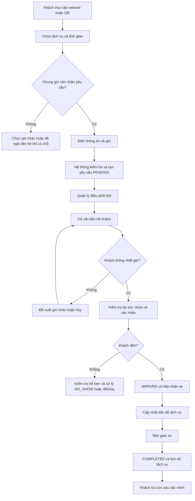
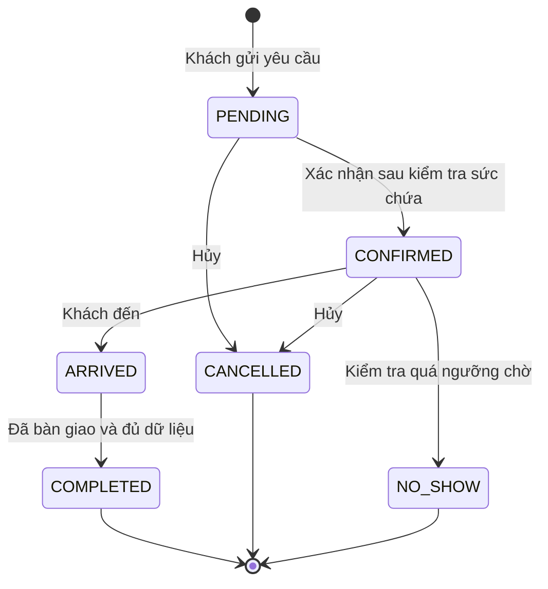
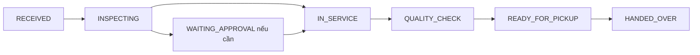

# DPAuto – USER FLOWS

> **Mã tài liệu:** DPA-UF-001  
> **Phiên bản:** 1.0 – Dự thảo nghiệp vụ  
> **Ngày:** 10/11/2026  
> **Nguồn:** `DPAuto_Conversation_Handoff_2026-11-09.md`, `DPAuto_Booking_Requirements.md` (09/11/2026), `BUSINESS_RULES.md` (10/11/2026).  
> **Phạm vi:** Website công khai, đặt lịch, trang quản lý, điều phối, tiến độ xe, tra cứu lịch sử, thông báo nội bộ.  
> **Trạng thái:** Chưa khóa nghiệp vụ; D01–D14 chưa được phê duyệt riêng.

## 1. Mục tiêu, ranh giới và cách đọc

Tài liệu mô tả **ai thao tác, thao tác ở đâu, hệ thống phản hồi gì, dữ liệu thay đổi ra sao và trường hợp lỗi xử lý thế nào**. Đây là đầu vào cho `UI_UX_SPEC.md`, `DATABASE_DESIGN.md`, `API_SPEC.md` và test E2E; không phải đặc tả giao diện pixel hay thiết kế endpoint.

DPAuto là hệ thống **độc lập** với phần mềm đặt lịch cũ. MVP **không** bao gồm quản lý kho, phiếu sửa chữa kỹ thuật chi tiết, báo giá/hóa đơn, thanh toán trực tuyến, ứng dụng native hoặc tự động hóa Zalo OA. Các bước về Zalo OA được ghi rõ là tương lai.

**Nhãn:** **[ĐÃ CHỐT]** = quyết định người dùng; **[THEO REQUIREMENTS – CHỜ DUYỆT]** = đã mô tả trong bản yêu cầu nhưng chưa duyệt chính sách cụ thể; **[ĐỀ XUẤT]** = cách tổ chức luồng bổ sung; **[CẦN XÁC NHẬN]** = phụ thuộc D01–D14. Luồng có nhãn chờ duyệt là **luồng thiết kế dự kiến**, không phải cam kết đã chốt.

**Ký hiệu:** `UF-xx` mã luồng; `AC-UF-xx` tiêu chí nghiệm thu; `BR-xx` quy tắc liên quan; `Dxx` quyết định còn mở. Tất cả thời gian hiển thị theo `Asia/Ho_Chi_Minh`.

## 2. Tác nhân, kênh và phạm vi quyền

| Tác nhân | Kênh | Quyền/phạm vi |
|---|---|---|
| Khách hàng | Website, QR | Đặt lịch không cần tài khoản; tra cứu dữ liệu **sau xác minh quyền** |
| Cố vấn dịch vụ (`ADVISOR`) | `/quanly` (đường dẫn dự kiến) | Tạo lịch; xem/sửa lịch **đang giao cho mình**; xem lịch sử đã từng phụ trách ở chế độ giới hạn |
| Quản lý (`MANAGER`) | `/quanly` | Xem toàn trạm; phân/chuyển lịch; cấu hình sức chứa; xử lý ngoại lệ; báo cáo và nhân sự |
| Hệ thống | API, DB, jobs | Kiểm tra quyền, sức chứa, tính hợp lệ, ghi audit, thông báo nội bộ |

**Nguyên tắc xuyên suốt:** API kiểm tra quyền **từng bản ghi**, không chỉ ẩn nút; khách không xem lịch sử chỉ bằng SĐT/biển số; một lịch chỉ có tối đa một cố vấn chính tại một thời điểm. Các chi tiết phân công mặc định vẫn phụ thuộc D01–D02.

## 3. Bản đồ hành trình tổng thể

> Sơ đồ là đường đi dự kiến theo Requirements. Các nhánh hàng đợi, giữ suất, trạng thái và cách xác minh cần duyệt D01–D14 trước khi khóa.

## 4. Danh mục luồng và màn hình

| Mã | Luồng | Tác nhân chính | Màn hình/điểm vào | Liên quan |
|---|---|---|---|---|
| UF-01 | Khám phá dịch vụ và vào đặt lịch | Khách | Trang chủ, dịch vụ, `/dat-lich`, QR | BR-07 |
| UF-02 | Gửi yêu cầu đặt lịch | Khách | `/dat-lich` | BR-07–09, BR-17–20; D03–D05 |
| UF-03 | Khung giờ đầy / danh sách chờ | Khách | `/dat-lich` | BR-17, BR-22; D03 |
| UF-04 | Tạo lịch nội bộ / walk-in | Advisor/Manager | Tạo lịch nhanh | BR-10–11, BR-23 |
| UF-05 | Phân công lịch mới | Manager | Hàng đợi, chi tiết lịch | BR-02, BR-04–06; D01–D02 |
| UF-06 | Xác nhận lịch và thương lượng giờ | Advisor/Manager | Chi tiết lịch | BR-12–13, BR-16, BR-20; D04 |
| UF-07 | Đổi lịch, hủy, khách không đến | Advisor/Manager | Chi tiết lịch | BR-14–16, BR-21 |
| UF-08 | Chuyển cố vấn phụ trách | Manager | Chi tiết lịch | BR-03, BR-06; D11 |
| UF-09 | Tiếp nhận khách và xe | Advisor/Manager | Lịch hôm nay, chi tiết | BR-24–25 |
| UF-10 | Cập nhật tiến độ xe | Advisor/Manager | Chi tiết lượt dịch vụ | BR-24–28; D07, D12 |
| UF-11 | Bàn giao và hoàn thành | Advisor/Manager | Chi tiết lượt dịch vụ | BR-27, BR-32; D06 |
| UF-12 | Tra cứu lịch/trạng thái/lịch sử | Khách | Trang tra cứu (URL chưa chốt) | BR-29–34; D08–D09 |
| UF-13 | Dashboard, lịch, tìm kiếm và lịch sử | Advisor/Manager | `/quanly` | BR-02–05, BR-36 |
| UF-14 | Cấu hình giờ và sức chứa | Manager | Cấu hình lịch tiếp nhận | BR-17–20, BR-23; D05 |
| UF-15 | Quản lý khách, xe và hồ sơ trùng | Manager/Advisor | Hồ sơ khách/xe | BR-32–34 |
| UF-16 | Thông báo nội bộ và việc cần xử lý | Advisor/Manager | Dashboard, trung tâm thông báo | BR-35–38 |
| UF-17 | Quản lý tài khoản, nhật ký, báo cáo | Manager | Cấu hình, báo cáo | BR-01–06, BR-39–41 |
| UF-18 | Xử lý sự cố, xung đột và ngoại lệ | Các tác nhân | Tại luồng phát sinh | BR-20, BR-39, BR-42 |

## 5. Luồng khách hàng

### UF-01 – Từ website/QR đến đặt lịch **[ĐÃ CHỐT]**

- **Điều kiện:** Website hoạt động; khách không cần đăng nhập.
- **Luồng chính:** (1) Khách xem trang chủ, dịch vụ hoặc tin tức; (2) chọn CTA **Đặt lịch**, hoặc quét QR; (3) mở `/dat-lich`; (4) xem danh mục dịch vụ và thông tin cần nhập.
- **Ngoại lệ:** QR sai/đường dẫn không khả dụng → hiển thị trang lỗi và đường dẫn điều hướng an toàn; dịch vụ đã ẩn → không cho đặt bằng ID cũ.
- **Kết quả:** Chưa tạo dữ liệu lịch cho đến khi khách gửi biểu mẫu.
- **AC-UF-01:** QR và CTA mở đúng trang; trang đặt lịch hoạt động trên điện thoại; không bắt đăng nhập.
- **Tham chiếu:** BR-07; Requirements §4–5.

### UF-02 – Khách gửi yêu cầu đặt lịch **[ĐÃ CHỐT + THEO REQUIREMENTS – CHỜ DUYỆT]**

- **Điều kiện:** Dịch vụ đang hoạt động; ngày/khung giờ được phép hiển thị; khách chưa cần tài khoản.
- **Luồng chính:**
  1. Chọn một hoặc nhiều dịch vụ (theo Requirements), ngày và khung giờ mong muốn.
  2. Hệ thống hiển thị giờ hoạt động, khung đóng/đầy và giờ khả dụng theo chính sách sức chứa.
  3. Nhập họ tên, SĐT; có thể nhập hãng/dòng xe, biển số, mô tả nhu cầu.
  4. Đọc thông tin xử lý dữ liệu; lựa chọn nhận quảng cáo **tách biệt, không chọn sẵn**.
  5. Nhấn **Gửi yêu cầu**; UI chặn nhấn lặp trong khi xử lý.
  6. Backend kiểm tra đầu vào, rate limit/chống spam, idempotency, lịch trùng và sức chứa **lại tại thời điểm gửi**.
  7. Nếu hợp lệ, tạo mã lịch và `PENDING` theo luồng Requirements; hiển thị **“Đã nhận yêu cầu – đang chờ xác nhận”** cùng giờ khách yêu cầu.
- **Nhánh:** Thiếu trường → báo lỗi ngay tại trường; hết suất giữa lúc chọn và gửi → yêu cầu chọn giờ khác; lỗi mạng sau gửi → kiểm tra idempotency/trạng thái trước khi gửi lại; bị rate limit → thông báo thử lại phù hợp, không lộ thông tin nội bộ.
- **Dữ liệu tạo:** Booking, dịch vụ yêu cầu, nguồn (website/QR), thông tin liên hệ, consent, audit/sự kiện tạo.
- **Không được:** Hiển thị “Đã xác nhận” khi chỉ vừa tạo `PENDING`; hứa giữ suất khi chính sách chưa chốt.
- **AC-UF-02:** Tạo thành công đúng một lịch `PENDING`; gửi lại không nhân đôi; sửa request để chọn giờ đầy bị backend từ chối; quảng cáo mặc định không đồng ý.
- **Cần chốt:** D03–D05 (danh sách chờ, giữ suất `PENDING`, cách tính sức chứa).
- **Tham chiếu:** BR-07–09, BR-17–20, BR-37, BR-42.

### UF-03 – Khung giờ đã đầy và yêu cầu liên hệ **[CẦN XÁC NHẬN – D03]**

- **Luồng chính dự kiến:** (1) Khách chọn dịch vụ/ngày; (2) giờ đầy bị vô hiệu hóa và có lý do; (3) hệ thống gợi ý giờ khác còn chỗ; (4) nếu duyệt tính năng danh sách chờ, khách chọn **Đề nghị liên hệ khi có chỗ**, nhập thông tin tối thiểu và khung mong muốn; (5) hệ thống ghi `waitlist_request` và thông báo **chưa phải lịch đã xác nhận**.
- **Nhánh:** Chưa triển khai danh sách chờ → chỉ gợi ý giờ khác hoặc kênh liên hệ; trống chỗ về sau → nhân viên chủ động liên hệ, chỉ đặt/đổi giờ khi khách đồng ý.
- **AC-UF-03 (dự kiến):** Không đặt trực tiếp giờ đầy; yêu cầu chờ không tự thành `CONFIRMED`; không tự chuyển lịch khi chưa được khách đồng ý.
- **Tham chiếu:** BR-17, BR-22.

### UF-12 – Khách tra cứu lịch, tiến độ và lịch sử **[ĐÃ CHỐT + CẦN XÁC NHẬN – D08, D09]**

- **Điều kiện:** Có dữ liệu DPAuto được ghi nhận; cơ chế xác minh quyền truy cập đã triển khai an toàn.
- **Luồng chính dự kiến (OTP):**
  1. Khách vào trang **Tra cứu** (URL cần chốt), nhập SĐT hoặc biển số để khởi tạo yêu cầu.
  2. Hệ thống phản hồi trung tính, **không xác nhận công khai hồ sơ có tồn tại**.
  3. Khách xác minh bằng OTP gửi tới số liên hệ đã liên kết với hồ sơ/lịch (hoặc cơ chế an toàn đã duyệt).
  4. Backend giới hạn thử sai, kiểm tra thời hạn và phạm vi quyền; tạo phiên truy cập ngắn hạn.
  5. Khách xem các lịch được phép xem, trạng thái lịch, tiến độ công khai, tóm tắt các lượt dịch vụ thực sự hoàn thành.
  6. Khách đóng/thoát phiên; hết hạn thì cần xác minh lại.
- **Phương án thay thế có điều kiện:** Nếu chưa có OTP, cấp **liên kết token khó đoán, có hạn, chỉ cho đúng một lịch**; **không** mở lịch sử toàn bộ theo SĐT/biển số.
- **Nhánh:** OTP sai/hết hạn → từ chối, cho thử lại theo giới hạn; đổi biển số/chủ xe → không suy đoán quyền xem; lịch chưa có dịch vụ hoàn thành → không tự dựng lịch sử sửa chữa; phiên hết hạn → yêu cầu xác minh lại.
- **Dữ liệu công khai:** Ngày/giờ, nhóm dịch vụ, trạng thái, tiến độ và cập nhật được đánh dấu công khai, tóm tắt dịch vụ đã xác nhận, ODO/mốc bảo dưỡng nếu chính sách cho phép.
- **Không được:** Trả ghi chú nội bộ, thông tin cố vấn nhạy cảm, lịch xe khác, giá vốn, thông tin cá nhân chỉ bằng biển số/SĐT.
- **AC-UF-12:** Chưa xác minh không đọc được lịch sử; token một lịch không mở lịch khác; chỉ hiển thị service visit thực tế; phân biệt `booking_status` và `service_progress`.
- **Tham chiếu:** BR-29–34; Requirements §8.

## 6. Luồng cố vấn và quản lý lịch

### UF-04 – Tạo lịch từ điện thoại/Fanpage/Zalo/walk-in **[ĐÃ CHỐT + THEO REQUIREMENTS – CHỜ DUYỆT]**

- **Điều kiện:** Nhân viên đăng nhập hợp lệ; có quyền tạo lịch.
- **Luồng chính:** (1) Chọn **Tạo lịch**; (2) nhập/tìm khách và xe trong phạm vi được phép; (3) chọn dịch vụ, nguồn, giờ mong muốn; (4) hệ thống kiểm tra trùng/sức chứa; (5) xác nhận tạo; (6) lưu người tạo, nguồn và sự kiện.
- **Phân công dự kiến:** Advisor tạo → tự giao mình; Manager tạo → chọn cố vấn hoặc chờ phân công (D01–D02).
- **Walk-in dự kiến:** Chọn **Tiếp nhận ngay**; nếu vượt ngưỡng thì cần Manager phê duyệt ngoại lệ có lý do, không âm thầm vượt tải.
- **Nhánh:** Khách trùng tên/SĐT → gợi ý kiểm tra, không tự gộp; lịch trùng → cảnh báo; vượt tải → chặn hoặc chuyển yêu cầu ngoại lệ; mạng lỗi → chống tạo trùng.
- **AC-UF-04:** Advisor không tạo lịch dưới danh nghĩa cố vấn khác; có nguồn và người tạo; không vượt tải trái quyền.
- **Tham chiếu:** BR-02, BR-04, BR-10–11, BR-23.

### UF-05 – Quản lý phân công lịch từ website **[CẦN XÁC NHẬN – D01, D02]**

- **Luồng dự kiến:** (1) Manager mở **Chờ phân công**; (2) xem lịch `PENDING` chưa có cố vấn; (3) chọn một lịch; (4) xem giờ, dịch vụ, khả năng tiếp nhận và tải của cố vấn; (5) chọn Advisor; (6) hệ thống kiểm tra quyền/phiên bản, lưu phân công và thông báo nội bộ; (7) Advisor thấy lịch trong **Việc của tôi**.
- **Nhánh:** Hai Manager phân công đồng thời → chỉ một thay đổi hợp lệ; Advisor ngừng hoạt động → không giao; lịch đã hủy → không giao; chưa có người phù hợp → giữ chờ.
- **AC-UF-05 (dự kiến):** Không có hai cố vấn chính; Advisor không tự xem hàng đợi chưa giao; thao tác phân công được audit.
- **Tham chiếu:** BR-04–06, BR-39, BR-42.

### UF-06 – Cố vấn liên hệ, xác nhận hoặc đề xuất giờ khác **[THEO REQUIREMENTS – CHỜ DUYỆT]**

- **Điều kiện:** Lịch `PENDING`, nhân viên đang phụ trách hoặc Manager.
- **Luồng chính:** (1) Mở lịch; (2) liên hệ khách ngoài hệ thống hoặc qua kênh sẵn có; (3) ghi nhận kết quả liên hệ; (4) nếu đồng ý, chọn giờ xác nhận; (5) backend kiểm tra quyền, trạng thái và sức chứa **trong transaction**; (6) chuyển `CONFIRMED`, lưu giờ xác nhận và sự kiện; (7) cập nhật dashboard.
- **Nhánh:** Khách chưa nghe máy → giữ `PENDING` và ghi việc cần liên hệ; muốn giờ khác → ghi giờ đề xuất, **không tự sửa giờ chính thức**; suất vừa bị chiếm → báo xung đột và đề nghị giờ khác; khách không muốn đến → xử lý hủy theo quyền.
- **AC-UF-06:** Chỉ người có quyền xác nhận; hai yêu cầu tranh suất cuối không cùng thành công; lịch không tự xác nhận khi khách chưa đồng ý.
- **Tham chiếu:** BR-12–13, BR-16, BR-19–20.

### UF-07 – Đổi giờ, hủy và không đến **[THEO REQUIREMENTS – CHỜ DUYỆT]**

**A. Đổi lịch:** (1) Advisor phụ trách/Manager mở lịch đủ điều kiện; (2) trao đổi giờ mới với khách; (3) chọn giờ mới và nhập lý do; (4) kiểm tra lại sức chứa; (5) cập nhật nguyên tử giờ cũ/giờ mới và audit; (6) hiển thị giờ mới. Nếu lỗi, **giữ nguyên giờ cũ**.

**B. Hủy lịch:** (1) Chọn hủy; (2) xác nhận và nhập lý do theo chính sách; (3) backend kiểm tra quyền/trạng thái; (4) chuyển `CANCELLED`; (5) giải phóng suất nếu lịch đang chiếm suất; (6) có thể gợi ý danh sách chờ. Không dùng hủy thông thường sau `ARRIVED`.

**C. Không đến:** (1) Hệ thống hiển thị cảnh báo quá giờ; (2) nhân viên kiểm tra đã qua giờ hẹn + ngưỡng chờ cấu hình và khách chưa đến; (3) xác nhận `NO_SHOW`; (4) ghi audit và giải phóng suất theo chính sách. **Không tự đánh dấu** chỉ vì đồng hồ quá giờ.

- **Nhánh chung:** Lịch `COMPLETED`/`CANCELLED` không được sửa bằng luồng thông thường; thao tác đồng thời → báo xung đột và tải lại.
- **AC-UF-07:** Đổi giờ lỗi không làm mất suất cũ; không đến trước ngưỡng bị chặn; lịch đã đến không bị hủy thường; lịch sử ghi ai, khi nào, vì sao.
- **Tham chiếu:** BR-14–16, BR-20–22; D10, D14.

### UF-08 – Quản lý chuyển người phụ trách **[ĐÃ CHỐT + THEO REQUIREMENTS – CHỜ DUYỆT]**

- **Luồng chính:** (1) Manager mở lịch; (2) chọn **Chuyển cố vấn**; (3) chọn Advisor mới và ghi lý do (đề xuất); (4) xác nhận; (5) backend kiểm tra quyền, người nhận, version; (6) ghi assignment mới, đóng assignment cũ và audit; (7) Advisor B nhận lịch, A mất quyền chỉnh sửa ngay.
- **Nhánh:** B trùng A → không cần chuyển; B bị khóa → từ chối; hai người cùng chuyển → một thao tác xung đột; A đang mở trang cũ → API từ chối cập nhật khi gửi.
- **Lịch sử của A:** Được xem phần công việc mình từng thực hiện; **phạm vi chi tiết sau chuyển chờ D11**, đề xuất chỉ đọc bản tóm tắt và sự kiện của mình, không thấy ghi chú nội bộ phát sinh về sau.
- **AC-UF-08:** A không thể sửa sau chuyển dù dùng API cũ; B xử lý được; không có hai người chính; lịch sử chuyển giao đầy đủ.
- **Tham chiếu:** BR-02–06, BR-39, BR-42.

## 7. Luồng xe tại trạm

### UF-09 – Đánh dấu khách đến và tiếp nhận xe **[THEO REQUIREMENTS – CHỜ DUYỆT]**

- **Điều kiện:** Lịch `CONFIRMED`, Advisor đang phụ trách hoặc Manager.
- **Luồng:** (1) Mở **Lịch hôm nay**; (2) đối chiếu khách/xe; (3) chọn **Đã đến**; (4) xác nhận; (5) chuyển `ARRIVED`; (6) tạo lượt phục vụ thực tế và mốc `RECEIVED` theo Requirements; (7) hiển thị giao diện tiến độ.
- **Nhánh:** Xe đến sai giờ → nhân viên xác nhận thực tế, hệ thống ghi giờ đến; xe chưa có biển số → bổ sung nếu có, không bắt buộc; lịch chưa xác nhận → không tự nhảy qua quy trình nếu chưa có chính sách ngoại lệ; đã đánh dấu đến → chống lặp.
- **AC-UF-09:** Không cập nhật tiến độ trước `ARRIVED`; có thời gian và người tiếp nhận; không tạo hai lượt phục vụ khi nhấn lặp.
- **Tham chiếu:** BR-12, BR-24–25.

### UF-10 – Cập nhật tiến độ xe **[ĐÃ CHỐT + CẦN XÁC NHẬN – D07, D12]**

- **Điều kiện:** Booking `ARRIVED`, lượt phục vụ còn hoạt động, người cập nhật có quyền.
- **Luồng:** (1) Advisor mở tiến độ; (2) chọn mốc phù hợp thực tế; (3) nhập cập nhật công khai và/hoặc ghi chú nội bộ; (4) nhập thời gian dự kiến nếu thực sự có căn cứ; (5) lưu; (6) hệ thống ghi sự kiện tiến độ và cập nhật phần **công khai** cho khách đã xác minh.
- **Bộ mốc dự kiến:** `RECEIVED` → `INSPECTING` → `WAITING_APPROVAL` (nếu có) → `IN_SERVICE` → `QUALITY_CHECK` → `READY_FOR_PICKUP` → `HANDED_OVER`. **Có thể bỏ qua mốc không áp dụng**, không tạo sự kiện giả.
- **Nhánh:** Dịch vụ tạm dừng/chờ khách → cập nhật phù hợp, không giả lập tiến độ; thay đổi dự kiến → hiển thị rõ là **dự kiến**; mạng mất → không hiển thị đã lưu nếu chưa xác nhận; Advisor đã bị chuyển lịch → bị từ chối ghi.
- **AC-UF-10:** Lưu actor/thời gian; ghi chú nội bộ không xuất hiện ở API khách; không tự đánh dấu xe đang sửa ngay khi xác nhận booking.
- **Tham chiếu:** BR-24–28; D07, D12.

### UF-11 – Bàn giao, hoàn thành và tạo lịch sử dịch vụ **[THEO REQUIREMENTS – CHỜ DUYỆT; D06]**

- **Luồng:** (1) Advisor/Manager xác nhận xe đã sẵn sàng; (2) khi thực sự bàn giao, chọn **Đã bàn giao**; (3) ghi `HANDED_OVER`; (4) nhập/kiểm tra tóm tắt dịch vụ thực hiện, ngày hoàn tất, ODO và mốc bảo dưỡng nếu có; (5) xác nhận hoàn thành; (6) hệ thống chuyển `COMPLETED`, đóng lượt phục vụ và tạo tóm tắt lịch sử được phép công bố.
- **Nhánh:** Chưa bàn giao → giữ `READY_FOR_PICKUP`, không tự hoàn thành; thiếu dữ liệu bắt buộc theo chính sách → yêu cầu bổ sung; sai sót sau hoàn thành → chỉ Manager xử lý ngoại lệ có lý do và audit.
- **AC-UF-11:** `COMPLETED` gắn lượt phục vụ thực tế; không tạo lịch sử dịch vụ từ booking hủy/không đến; không hoàn thành khi chưa đủ điều kiện bàn giao.
- **Tham chiếu:** BR-15, BR-27, BR-32–33; D06, D10.

## 8. Luồng vận hành trang quản lý

### UF-13 – Dashboard, lịch ngày/tuần, tìm kiếm và lịch sử cá nhân **[ĐÃ CHỐT + THEO REQUIREMENTS – CHỜ DUYỆT]**

- **Advisor:** (1) đăng nhập; (2) thấy lịch hôm nay, cần xác nhận, sắp đến, xe đang phục vụ **của mình**; (3) lọc ngày/trạng thái; (4) tìm tên/SĐT/biển số/mã lịch **chỉ trong phạm vi được phép**; (5) mở chi tiết và thao tác; (6) vào **Lịch sử công việc** để xem cả lịch đã từng phụ trách ở chế độ giới hạn.
- **Manager:** (1) đăng nhập; (2) xem toàn trạm và hàng đợi; (3) lọc theo cố vấn, ngày, trạng thái; (4) mở lịch để phân công/điều phối; (5) xem báo cáo tổng hợp.
- **Thiết bị:** Ưu tiên mobile/tablet, thao tác nhanh bằng thẻ/drawer; desktop có thể dùng lịch/bảng tổng hợp. Đây là hướng UI, chi tiết chốt tại `UI_UX_SPEC.md`.
- **Nhánh:** Không có dữ liệu → empty state; mất mạng → error/retry; không còn quyền khi đang mở chi tiết → ẩn dữ liệu và yêu cầu tải lại; bộ lọc không được mở rộng quyền.
- **AC-UF-13:** Advisor không nhìn thấy lịch người khác qua tìm kiếm/thống kê; Manager lọc toàn trạm; trên mobile thao tác được mà không cần bảng quá rộng.
- **Tham chiếu:** BR-02–05, BR-36; Requirements §7.

### UF-14 – Quản lý cấu hình giờ hoạt động và sức chứa **[ĐÃ CHỐT + CẦN XÁC NHẬN – D04, D05]**

- **Luồng:** (1) Manager mở **Cấu hình tiếp nhận**; (2) đặt giờ làm, nghỉ trưa, ngày nghỉ/đóng đột xuất, độ dài khung, giới hạn số lượt, thời gian đặt trước và ngưỡng cảnh báo; (3) xem trước tác động; (4) lưu; (5) hệ thống áp dụng cho các khung khả dụng trên website và các lần xác nhận mới.
- **Nhánh:** Giảm sức chứa thấp hơn số lịch đã xác nhận → **không âm thầm hủy lịch hiện có**; cảnh báo xung đột, yêu cầu Manager điều phối; thay đổi khi khách đang đặt → backend dùng cấu hình mới nhất để kiểm tra khi gửi; Advisor truy cập → từ chối.
- **AC-UF-14:** Ngày nghỉ/khung đóng không thể đặt mới; thay đổi có audit; lịch đã xác nhận không bị xóa/đổi âm thầm.
- **Tham chiếu:** BR-17–20, BR-23; D04–D05.

### UF-15 – Hồ sơ khách hàng, xe và dữ liệu trùng **[THEO REQUIREMENTS – CHỜ DUYỆT + ĐỀ XUẤT]**

- **Luồng:** (1) Nhân viên có quyền mở hồ sơ trong phạm vi công việc; (2) tìm xe/khách; (3) xem thông tin liên quan lịch đang xử lý; (4) bổ sung/sửa thông tin hợp lệ; (5) nếu nghi trùng, chuyển Manager kiểm tra; (6) Manager xác minh và ghi audit trước khi gộp/chuyển liên kết.
- **Nhánh:** Cùng biển số nhưng khác người liên hệ → không tự gộp; đổi chủ/biển số → không tự cấp quyền tra cứu lịch sử cho người mới; Advisor tìm khách ngoài phạm vi → không trả hồ sơ đầy đủ.
- **AC-UF-15:** Xe dùng ID nội bộ, không dùng biển số làm khóa; gộp có kiểm tra và audit; tìm kiếm không lộ dữ liệu ngoài quyền.
- **Tham chiếu:** BR-11, BR-31–34, BR-39.

### UF-16 – Thông báo nội bộ và danh sách cần xử lý **[THEO REQUIREMENTS – CHỜ DUYỆT]**

- **Luồng:** (1) Có lịch mới/được giao, lịch cần xác nhận, gần giờ, đổi/hủy, quá tải; (2) hệ thống ghi sự kiện và hiển thị cảnh báo cho đúng vai trò; (3) nhân viên mở cảnh báo đến lịch tương ứng; (4) thực hiện liên hệ/cập nhật; (5) đánh dấu đã xem hoặc đã xử lý theo thiết kế sau này.
- **Nhánh:** Advisor bị chuyển lịch → không còn đọc cảnh báo dẫn đến dữ liệu hiện tại không thuộc quyền; gửi thông báo thất bại → booking vẫn hợp lệ; không tự đánh dấu `NO_SHOW`.
- **Zalo OA tương lai:** Jobs gửi xác nhận/nhắc hẹn/bàn giao/hậu mãi, chống gửi trùng và phân biệt tin dịch vụ/quảng cáo. **Không triển khai như luồng MVP bắt buộc.**
- **AC-UF-16:** Cảnh báo không làm lộ lịch của Advisor khác; lỗi kênh thông báo không rollback booking.
- **Tham chiếu:** BR-35–38; D13.

### UF-17 – Tài khoản, audit và báo cáo **[THEO REQUIREMENTS – CHỜ DUYỆT]**

- **Luồng tài khoản:** Manager tạo/khóa tài khoản nội bộ, gán một trong hai vai trò; hệ thống thực thi quyền ngay tại backend. Cơ chế đăng nhập cụ thể được thiết kế trong tài liệu kiến trúc.
- **Luồng audit:** Manager xem ai tạo/xác nhận/đổi/hủy/chuyển lịch, sửa cấu hình, thay quyền; có bộ lọc theo ngày/nhân viên/hành động.
- **Luồng báo cáo:** Manager xem số lịch theo ngày, cố vấn, trạng thái, nguồn và tỷ lệ đến/không đến; Advisor chỉ xem thống kê cá nhân trong phạm vi cho phép.
- **Nhánh:** Nhân viên bị khóa khi đang đăng nhập → thao tác tiếp theo bị từ chối; bản ghi audit không bị sửa tùy tiện; báo cáo không tiết lộ dữ liệu cá nhân quá mức.
- **AC-UF-17:** Advisor không truy cập quản lý tài khoản/audit toàn trạm; thay quyền có hiệu lực tại API; số liệu phân quyền đúng.
- **Tham chiếu:** BR-01–06, BR-39–41; D13.

## 9. Luồng lỗi và tình huống ngoại lệ

### UF-18 – Xử lý xung đột và khôi phục **[THEO REQUIREMENTS – CHỜ DUYỆT + ĐỀ XUẤT]**

| Mã | Tình huống | Hành vi mong đợi | Kiểm tra |
|---|---|---|---|
| EX-01 | Hai người xác nhận suất cuối | Một giao dịch thành công; giao dịch còn lại báo hết suất | Không vượt capacity |
| EX-02 | Hai người đổi cùng lịch | Kiểm tra version/trạng thái; không ghi đè im lặng | Có conflict rõ ràng |
| EX-03 | Advisor bị chuyển lịch khi đang mở | Chặn cập nhật bằng quyền hiện tại | Không vượt quyền bằng API |
| EX-04 | Khách gửi form hai lần | Idempotency; không tạo lịch trùng do retry | Một yêu cầu logic |
| EX-05 | Giờ vừa bị khóa/đầy khi gửi | Backend từ chối và gợi ý chọn lại | Không tin dữ liệu UI cũ |
| EX-06 | Đổi giờ thất bại giữa giao dịch | Rollback, giữ nguyên giờ/suất cũ | Dữ liệu nhất quán |
| EX-07 | Khách không đến nhưng chưa hết ngưỡng | Không cho `NO_SHOW` | Theo D14 |
| EX-08 | Xe đã đến nhưng yêu cầu hủy thường | Chặn; chuyển quy trình ngoại lệ Manager | Có lý do và audit |
| EX-09 | OTP/token sai, hết hạn, dò đoán | Từ chối; giới hạn thử; phản hồi không tiết lộ hồ sơ | Không lộ dữ liệu |
| EX-10 | Ghi chú nội bộ bị gắn nhầm công khai | Có xác nhận/phân tách trường; API khách chỉ allowlist | Không lộ ghi chú |
| EX-11 | Giảm sức chứa dưới số đã xác nhận | Cảnh báo; không tự hủy lịch | Điều phối thủ công |
| EX-12 | Lỗi gửi thông báo | Booking vẫn được lưu; job lỗi để xử lý lại | Không rollback booking |
| EX-13 | Mất mạng khi lưu tiến độ | Không báo thành công khi chưa xác nhận; cho retry an toàn | Không tạo sự kiện giả |
| EX-14 | Xe đổi biển số/chủ sở hữu | Không tự cấp quyền xem lịch sử cũ | Xác minh quyền riêng |
| EX-15 | Nhân viên cố tìm lịch người khác | Backend giới hạn bản ghi và kết quả tìm kiếm | Không rò dữ liệu |
| EX-16 | Dữ liệu lịch sử cũ không có trong DPAuto | Hiển thị không có dữ liệu được ghi nhận, không suy diễn | Không dựng lịch sử giả |

**Lưu ý:** Những hành vi đề xuất như kiểm tra version, xác nhận khi công khai ghi chú hoặc cảnh báo trước khi giảm sức chứa cần đưa vào đặc tả kỹ thuật sau khi duyệt.

## 10. Vòng đời trạng thái và điều kiện chuyển

### 10.1. Lịch hẹn (`booking_status`) – bộ trạng thái trong Requirements, **chờ duyệt**

- `PENDING` không đồng nghĩa giữ chỗ; cơ chế chiếm suất chờ D04.
- Đổi giờ là **hành động** có kiểm tra sức chứa và audit, không nhất thiết là trạng thái mới.
- `ARRIVED` không chuyển hủy theo luồng thông thường; sửa/mở lại `COMPLETED` chỉ là ngoại lệ Manager.

### 10.2. Tiến độ xe (`service_progress`) – bộ mốc dự kiến, **chờ D07, D12**

Sơ đồ minh họa đường đi thường gặp, **không bắt buộc đi qua tất cả mốc**. Việc bỏ qua mốc phải phản ánh đúng thực tế, không tạo sự kiện giả. Danh mục và chuyển mốc chính xác cần xác nhận với cố vấn.

## 11. Ma trận màn hình – hành động – dữ liệu

| Màn hình | Vai trò | Hành động chính | Dữ liệu cần hiển thị |
|---|---|---|---|
| Trang chủ/dịch vụ | Khách | Xem dịch vụ, bấm đặt lịch | Nội dung công khai |
| `/dat-lich` | Khách | Chọn dịch vụ/giờ, gửi | Khung khả dụng, biểu mẫu, kết quả |
| Tra cứu (URL chưa chốt) | Khách đã xác minh | Xem lịch, tiến độ, lịch sử | Chỉ dữ liệu công khai thuộc quyền |
| Dashboard | Advisor | Xem việc của tôi, thao tác nhanh | Lịch được giao, cảnh báo |
| Dashboard | Manager | Xem toàn trạm, điều phối | Tổng quan, hàng đợi, quá tải |
| Lịch ngày/tuần | Advisor/Manager | Lọc và mở lịch | Theo phạm vi quyền |
| Danh sách lịch | Advisor/Manager | Tìm, lọc, mở chi tiết | Mã, giờ, trạng thái, nguồn, cố vấn |
| Chi tiết lịch | Advisor/Manager | Xác nhận, đổi, hủy, chuyển, tiếp nhận | Khách/xe, dịch vụ, sự kiện, tiến độ |
| Lịch sử công việc | Advisor | Xem lịch đã từng làm | Chỉ phần lịch sử được phép |
| Khách/xe | Advisor/Manager | Tìm, bổ sung, kiểm tra trùng | Dữ liệu tối thiểu theo quyền |
| Cấu hình tiếp nhận | Manager | Sửa giờ/ngày nghỉ/capacity | Cấu hình và cảnh báo tác động |
| Nhân sự/báo cáo/audit | Manager | Quản lý, lọc, kiểm tra | Tài khoản, chỉ số, nhật ký |

## 12. Quy tắc trải nghiệm chung cho UI/UX

1. **Mobile-first** cho trang quản lý: cố vấn thao tác một tay khi tiếp khách; tablet là thiết bị trọng tâm thứ hai; desktop hỗ trợ quản lý toàn trạm.
2. Trên mobile ưu tiên thẻ lịch, tìm kiếm nhanh, bộ lọc và chi tiết toàn màn hình/drawer; không bắt buộc dùng bảng rộng.
3. Mỗi trạng thái có **nhãn chữ**, không chỉ phân biệt bằng màu; màu chủ đạo đỏ–trắng theo thương hiệu.
4. Các hành động thường xuyên (tạo lịch, xác nhận, đánh dấu đến, cập nhật tiến độ) dễ tiếp cận; thao tác hủy/chuyển/mở lại có xác nhận.
5. Tất cả màn hình có trạng thái **loading, empty, error, success, conflict, permission denied**; tránh gửi lặp khi mạng chậm.
6. Phân biệt **giờ khách yêu cầu**, **giờ đã xác nhận** và **giờ dự kiến hoàn tất**; không dùng nhãn gây hiểu nhầm.
7. Thông tin nội bộ và thông tin khách được xem phải có phân tách rõ ràng ở UI **và API**.
8. Chưa chốt đường dẫn ngoài `/dat-lich` và `/quanly`; các route còn lại để `UI_UX_SPEC.md` xác định.

## 13. Ma trận kiểm thử E2E theo hành trình

| Nhóm | Kịch bản E2E tối thiểu | Kết quả cần đạt |
|---|---|---|
| E2E-01 | Khách mở QR → chọn dịch vụ → gửi lịch | Một booking hợp lệ, trạng thái chờ xác nhận |
| E2E-02 | Khách chọn giờ đầy / giờ vừa hết suất | UI và backend đều chặn |
| E2E-03 | Manager phân công → Advisor xác nhận | Đúng người phụ trách, đúng sức chứa |
| E2E-04 | Advisor A cố xem/sửa lịch B | Bị từ chối ở API và UI |
| E2E-05 | Manager chuyển A→B | A mất quyền sửa ngay, B nhận quyền |
| E2E-06 | Đổi giờ thành công/thất bại | Suất cũ/mới nhất quán, có audit |
| E2E-07 | Đánh dấu khách không đến | Chỉ khi đúng điều kiện và xác nhận thủ công |
| E2E-08 | Xe đến → tiến độ → bàn giao | Có sự kiện, `COMPLETED`, lịch sử dịch vụ |
| E2E-09 | Khách tra cứu chưa xác minh | Không lộ lịch sử/tiến độ nhạy cảm |
| E2E-10 | OTP/token đúng/sai/hết hạn | Chỉ đúng phạm vi, giới hạn thử |
| E2E-11 | Hai cố vấn tranh suất cuối | Không vượt sức chứa |
| E2E-12 | Lỗi mạng khi tạo/cập nhật | Không nhân đôi hoặc báo thành công giả |
| E2E-13 | Manager đóng ngày, giảm sức chứa | Chặn lịch mới; không tự hủy lịch cũ |
| E2E-14 | Advisor xem lịch sử đã chuyển | Chỉ đọc đúng dữ liệu quá khứ cho phép |
| E2E-15 | Lỗi thông báo | Booking vẫn nhất quán |

Các kịch bản gắn D01–D14 chỉ trở thành tiêu chí nghiệm thu **chính thức** sau khi quyết định tương ứng được duyệt.

## 14. Danh sách quyết định còn mở và ảnh hưởng đến luồng

| Mã | Quyết định chưa chốt | Luồng bị ảnh hưởng | Phương án đang mô tả (chưa duyệt) |
|---|---|---|---|
| D01 | Ai xử lý lịch khách đặt mới? | UF-05, UF-06 | Manager phân công từ hàng đợi |
| D02 | Advisor được tự nhận lịch chưa giao? | UF-04, UF-05 | Không |
| D03 | Khung đầy có danh sách chờ? | UF-03, UF-07 | Có yêu cầu liên hệ |
| D04 | `PENDING` có giữ suất? | UF-02, UF-06, UF-14 | Không giữ; giới hạn số yêu cầu chờ |
| D05 | Sức chứa chung hay theo nhóm dịch vụ? | UF-02, UF-14 | Tổng lượt tiếp nhận/khung |
| D06 | Ai hoàn thành lượt phục vụ? | UF-11 | Advisor phụ trách hoặc Manager |
| D07 | Có được bỏ qua mốc tiến độ? | UF-10 | Có, nếu không áp dụng |
| D08 | Phương thức xác minh tra cứu? | UF-12 | OTP; token từng lịch nếu chưa sẵn sàng |
| D09 | Phạm vi lịch sử cũ? | UF-12 | Chỉ dữ liệu DPAuto/import đã xác minh |
| D10 | Hủy/đổi sau khi xe đến? | UF-07, UF-11 | Manager xử lý ngoại lệ |
| D11 | Advisor cũ còn xem gì? | UF-08, UF-13 | Chỉ tóm tắt và thao tác trước chuyển |
| D12 | Mốc tiến độ theo nhóm dịch vụ? | UF-10 | Bộ mốc chung, có thể bỏ qua |
| D13 | Ai quản lý dịch vụ/nội dung website? | UF-16, UF-17 | Manager trong MVP |
| D14 | Ngưỡng chờ trước `NO_SHOW`? | UF-07 | Manager cấu hình |

**Thông số phụ cần làm rõ:** thời lượng khung, số suất/khung, giờ mở cửa/ngày nghỉ, số ngày đặt trước, hạn mức `PENDING`, thời gian giữ token/OTP, thời hạn phiên tra cứu, thông tin bắt buộc khi hoàn thành và mức độ công khai lịch sử. Không tự gán giá trị mặc định thành quyết định đã chốt.

## 15. Điều kiện hoàn tất tài liệu và bàn giao bước tiếp

- [ ] Manager/cố vấn rà soát và duyệt D01–D14; ghi người duyệt, ngày duyệt và phương án được chọn.
- [ ] Xác nhận danh mục trạng thái lịch và mốc tiến độ theo thực tế trạm.
- [ ] Xác nhận luồng đặt lịch khi đầy, chính sách giữ suất và vượt tải.
- [ ] Xác nhận phương thức xác minh khách trước khi mở tra cứu công khai.
- [ ] Chốt trường dữ liệu tối thiểu và phạm vi thông tin khách được xem.
- [ ] Rà soát UF-01–UF-18 với ít nhất một Manager và một Advisor bằng tình huống thật.
- [ ] Sau khi duyệt, chuyển sang `UI_UX_SPEC.md` (màn hình, thành phần, trạng thái) và `DATABASE_DESIGN.md` (thực thể, quan hệ, transaction), rồi `API_SPEC.md`.

**Quy tắc kiểm soát thay đổi:** Mọi thay đổi làm khác quyết định đã chốt phải cập nhật Requirements, Business Rules, User Flows và test tương ứng; không để Codex tự suy đoán nghiệp vụ còn mở.

---

*Hết tài liệu DPA-UF-001 – USER_FLOW.md.*
